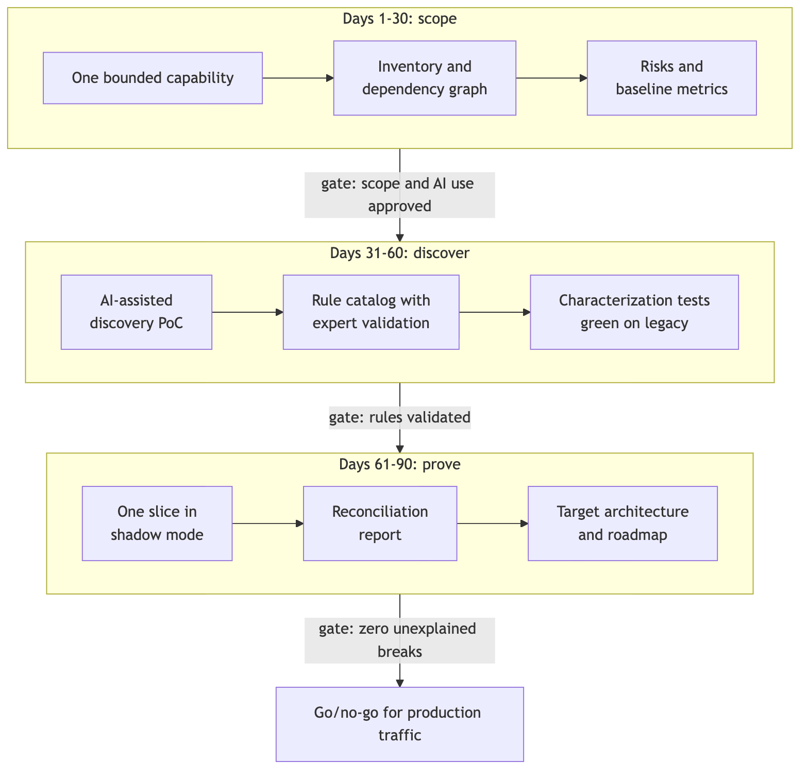

# Banking modernization with AI


[](LICENSE) [](docs/diagrams) [](#why-banks-modernize) [](#where-ai-helps-and-where-it-must-not-decide) [](https://eur-lex.europa.eu/eli/reg/2022/2554/oj) [](examples/java)

Modernizing a bank's legacy core is not a COBOL-to-Java translation job. The hard part is the knowledge buried in the code: decades of interest, fee, rounding, eligibility and reconciliation rules, batch cycles nobody fully remembers, and data formats that break naive conversions. Rewrite before you understand, and you replace a reliable system with a less reliable one.

This project describes a different way to approach it. A solution architect turns the undocumented legacy estate into business capabilities that can be understood, tested and modernized one slice at a time. AI speeds up the slow parts (discovery, rule extraction, test generation, discrepancy analysis), while deterministic tooling and people keep the authority over financial correctness.

It is the companion to [legacy-modernization-patterns](https://github.com/wallaceespindola/legacy-modernization-patterns), which catalogs the migration patterns themselves (Strangler Fig, ACL, CDC, Parallel Run and the rest). This one covers the people and process side: what makes banking modernization hard, what the architect owns, where AI fits, and how to run a first 90-day initiative.

## In short

- **Change capabilities, not programs.** Move one business capability at a time (fees, statements, customer inquiry), not one program or one language at a time.
- **Prove equivalence before cut-over.** The legacy system is the test oracle. Characterization tests, a parallel run and reconciliation to the cent decide when a slice is done.
- **Let AI propose, never approve.** Parsers produce the facts, AI interprets them, domain experts approve the rules, and tests prove them.
- **Plan the switch-off.** Coexistence means paying for two platforms; every migrated slice needs a decommissioning date.

## Why banks modernize

Banks keep mainframes for good reasons: they are fast, stable, well audited and already paid for. What erodes is everything around them.

- **Knowledge leaves.** The engineers who know the business rules retire, and the rules were never written down outside the code.
- **Change gets slower.** Tests are thin and dependencies hide in shared copybooks, files and job schedules, so every change is risky and expensive to validate.
- **Channels moved on.** Mobile and open banking expect real-time behavior from systems designed around overnight batch.
- **Regulation got stricter.** DORA, applicable since 17 January 2025, asks for ICT risk management, resilience testing and control over third parties, including cloud and AI providers.

Big-bang rewrites have a poor track record in this setting. AI makes a faster rewrite tempting, but the bottleneck was never typing speed. It was understanding. Used well, AI shortens the time it takes to understand a legacy system. Used badly, it produces confident translations of rules nobody checked.

## What makes it hard

The difficulty is rarely the COBOL syntax. It sits in five places at once.

**People and organization.** Mainframe skills are scarce, and the rules often live in a few specialists' heads. The org chart tends to mirror the monolith, so new service boundaries fail unless team ownership changes with them. Run teams are rewarded for stability and change teams for delivery, while modernization needs both.

**Technology.** Large coupled applications carry business rules for interest, fees, rounding, eligibility and tax. The runtime is more than COBOL: CICS and IMS transactions, JCL, schedulers, assembler, PL/I and vendor packages. Shared copybooks and files act as implicit contracts between programs that never call each other, and dead or duplicated code inflates the scope if nobody finds it early.

**Architecture and integration.** Monolithic boundaries rarely match business capabilities. The core is wired to payments, cards, risk, fraud and regulatory reporting, often through fixed-width files and MQ messages with consumers nobody has a full list of. Batch semantics are easy to lose in a rewrite: cut-off times, end-of-day ordering, checkpoint and restart, and "process exactly once per business date".

**Data and correctness.** This is where naive ports break.

- `COMP-3` packed decimal, signed zoned decimal, `REDEFINES`, `OCCURS DEPENDING ON` and implied decimal points need careful decoding.
- EBCDIC sorts differently from ASCII, so a sorted report can change order after migration.
- COBOL truncates unless `ROUNDED` is specified, and its intermediate precision differs from Java's. Money must be `BigDecimal` with an explicit scale and `RoundingMode` per rule, never `double`.
- Julian dates, century windowing left over from Y2K fixes and business-day calendars all carry rules of their own.

**Risk, governance and cost.** Availability, disaster recovery and traceability can't regress. During coexistence the bank pays for both platforms, and there is a real risk of replacing a reliable mainframe workload with a more complex and less reliable distributed design.

## Core principles

| Principle | What it means in practice |
| --- | --- |
| Modernize capabilities, not code | The unit of change is a business capability such as fee calculation or statements. Line-by-line translation produces "JOBOL": Java that keeps the COBOL structure, coupling and batch assumptions |
| Correctness is proven, not assumed | Characterization tests, parallel runs and ledger-level reconciliation decide when a slice is done |
| AI proposes, deterministic tooling verifies, humans approve | AI shortens the work; it never becomes the authority on financial behavior |
| Decommission, don't just build | Every slice has a date when the legacy part is switched off, or the bank pays for two platforms indefinitely |

The principles turn into one loop that repeats for every capability:


Parsers and static analysis map the estate. AI turns that map into readable summaries and candidate rules. Domain experts sign the rules off, characterization tests capture what the legacy system actually does, and the new slice runs in shadow mode until reconciliation shows no unexplained breaks. A break doesn't mean the new code is wrong by default; it often means a rule was missed, so it goes back to the rule catalog first.

## Choosing a strategy per capability

No single strategy fits a whole bank. Each capability gets its own decision, based on value, risk and coupling.

| Strategy | Good fit | Main risk |
| --- | --- | --- |
| Retain and expose through APIs | Stable core ledger, high throughput, low change rate | Skills risk and cost stay |
| Rehost or replatform | Hardware or licensing exit pressure, low change demand | Same design, new operational complexity |
| Automated refactor to Java or C# | Large, well-tested estate, short timeline | "JOBOL"; maintainability doesn't improve |
| Rearchitect as domain services | High-change, differentiating capabilities | Rule loss, long parallel run |
| Replace with a package or SaaS | Commodity capabilities | Customization creep, vendor lock-in |
| Retire | Dead code, obsolete products | Hidden consumers |

## Incremental coexistence

For the capabilities that get rebuilt, the recommended pattern is an incremental strangler with controlled coexistence.


- **Routing layer:** switches traffic per capability, product or customer segment, with instant fallback to legacy.
- **Anti-corruption layer:** keeps legacy data models and codes out of the new domain model.
- **Change data capture instead of dual writes:** one writer per data element during coexistence, so the two stores can't silently diverge.
- **Shadow mode and parallel run:** the new service computes results without committing them, and differences are reconciled before any cut-over.
- **One system of record per business date:** written down explicitly, so there is never doubt about which ledger is right.

## The architect's role

The solution architect owns the shape of the transformation, not only the target picture:

- Reconstruct the current state: applications, interfaces, data flows, jobs and dependencies.
- Define capabilities and domain boundaries together with domain experts.
- Set the target and transition architectures, and choose the consistency model per capability: strong consistency for postings and balances, eventual consistency where statements, analytics or notifications allow it.
- Fix non-functional targets up front (end-of-day throughput, latency, RPO and RTO, batch window), so the new design is measured against the mainframe it replaces.
- Plan waves by value, feasibility and risk, and make the business case honest: cost of coexistence, decommissioning milestones and the cost of not acting.
- Govern the quality gates (equivalence, reconciliation, observability, rollback) and keep regulatory evidence in the delivery pipeline as ADRs, test evidence and reconciliation reports.

Just as important is what the architect prevents: a big-bang cut-over weekend, a distributed monolith sharing one database, dual writes from application code, batch jobs translated one-to-one into microservices, floating-point money, and idempotency or replay left for after go-live.

## Where AI helps, and where it must not decide

AI is useful across the whole loop, as long as every use comes with a control:

| Area | What AI does | Control that keeps it safe |
| --- | --- | --- |
| Discovery | Summarizes programs, copybooks, jobs and dependencies | Grounded on parser output, cites file and line |
| Rule extraction | Proposes candidate business rules with source links | Domain expert sign-off, rule catalog with status |
| Domain modeling | Suggests bounded contexts and service boundaries | Coupling metrics and domain workshops |
| Code modernization | Assists transformation and refactoring | Code review, static analysis, characterization tests pass |
| Data mapping | Proposes schema translations, flags inconsistent records | Profiling on masked data, reconciled totals |
| Testing | Generates characterization tests and edge cases, explains breaks | The legacy system is the oracle, not the model |
| Operations | Explains abends, job failures and reconciliation breaks | Read-only access, no autonomous production actions |


The key design choice is the split between facts and interpretation. The dependency graph comes from deterministic parsers and static analysis, so it is reproducible. The model explains and reasons over that graph, which moves the risk of hallucination into the interpretation layer, where expert review happens anyway. Before trusting the pipeline on unknown code, measure its precision and recall on programs whose rules are already known.

Governance comes before the first prompt:

- **Deployment:** models run inside the bank's approved perimeter, with contractual terms on data retention and training use. Under DORA, the model provider is an ICT third party.
- **Data:** source code is intellectual property and may contain hard-coded data. Samples are masked or synthetic before they reach a model.
- **Prompt injection:** comments and strings in legacy code are untrusted input. Agents get least privilege and no write access to production.
- **Reproducibility:** model versions are pinned, prompts and outputs stored, evaluations re-run on every model upgrade.
- **Accountability:** a named person owns each approved rule, mapping and code change. AI is recorded as an assistant, never as the approver.

## Proving equivalence

Equivalence with the legacy system is the acceptance criterion for every slice. Several techniques work together:

- **Characterization (golden master) tests:** capture legacy outputs for representative and edge-case inputs before changing anything.
- **Record and replay:** replay masked production transactions and batch inputs against both systems.
- **Differential testing:** compare outputs field by field, with a tolerance policy that is normally zero for amounts.
- **Property-based testing:** for rounding, interest accrual, fee caps and currency conversion.
- **Reconciliation at three levels:** record, account balance and general-ledger totals per business date.
- **Parallel run:** for at least one full business cycle, including month-end and, where relevant, year-end.
- **Operational tests:** failover, restart in the middle of a batch, duplicate messages and replay.

Why zero tolerance? A one-cent difference per account per month is invisible in a demo and very visible across a whole portfolio and in an audit. The runnable example below shows exactly how such a difference appears.

## A first 90 days

A first initiative should be valuable enough to matter and bounded enough to finish. Good first candidates have a clear business owner with available experts, low write coupling to the core ledger (fee calculation, statement generation, customer inquiry), outputs that can be compared with legacy field by field, and pain the business already feels.

| Phase | Focus | Gate |
| --- | --- | --- |
| Days 1-30 | Select the capability, inventory programs and dependencies, capture risks, set baseline metrics, interview experts | Scope signed off, AI use approved by security and risk |
| Days 31-60 | AI-assisted discovery proof of concept, rule catalog, data and service boundaries, characterization tests | Rule catalog with validation status, characterization suite green on legacy |
| Days 61-90 | One slice in shadow mode, reconciliation against legacy, target architecture and roadmap | Reconciliation report, ADRs, go/no-go for production traffic |



Go/no-go criteria are agreed before the slice is built, not after. Once code exists, every discrepancy turns into a negotiation. Settle early who signs off the tolerance policy, which system is the book of record for each data element, and when each migrated legacy component gets switched off.

## Measuring success

Every metric gets a baseline in the first 30 days and a target agreed with stakeholders:

- **Discovery effort:** person-days to document a program or capability, with and without AI.
- **Rule quality:** rules confirmed by experts as a share of candidates, and extraction precision and recall on the evaluation set.
- **Coverage:** critical dependencies found before testing versus after, and rules covered by automated tests.
- **Correctness:** count and value of reconciliation breaks per business date, by root cause, and defect escape rate after go-live.
- **Delivery:** change lead time for the migrated capability, before and after.
- **Resilience:** incidents, MTTR, RPO and RTO met in tests, batch window adherence.
- **Cost and value:** run cost of legacy plus new during coexistence, mainframe capacity actually released, and the business outcome of the capability.

## Runnable example

Correctness has to be proven, so the repo includes one small proof. `examples/cobol/INTCALC.cbl` holds an illustrative interest rule: a `COMPUTE` with no `ROUNDED` phrase, which truncates to two decimals. `examples/java/` ports it to Java 25 and proves the port against a golden master:

- `PackedDecimal` decodes `COMP-3` fields, including sign-nibble validation.
- `InterestRule` is the legacy-equivalent port (`RoundingMode.DOWN`), next to a naive port with banker's rounding that a reviewer could easily accept.
- `Reconciler` compares legacy and modern results per account with zero tolerance.
- `InterestRuleGoldenMasterTest` shows the correct port reconciling and the naive one breaking on 3 of 8 accounts by one cent: 1000.00 at 5.00% gives 4.16 in COBOL and 4.17 in the naive port.

The golden CSV is an illustrative fixture worked out by hand from the COBOL semantics, not data from a real bank. The matching rule catalog entry is in [`docs/templates/rule-catalog-entry.md`](docs/templates/rule-catalog-entry.md).

```bash
make test   # or: cd examples/java && mvn -q test
```

## When it doesn't pay off

This approach has a fixed cost: discovery, a rule catalog, characterization tests and a parallel run before any traffic moves. That is the right trade for calculation-heavy capabilities with money attached. It is a poor fit for a stable core ledger with low change demand (retain it and expose it through APIs), for commodity capabilities (a package may beat a rebuild), for dead or duplicated code (retire it after checking for hidden consumers), and for any capability without domain experts available to approve the rules.

## References

- [Regulation (EU) 2022/2554 (DORA)](https://eur-lex.europa.eu/eli/reg/2022/2554/oj)
- [Strangler Fig Application, Martin Fowler](https://martinfowler.com/bliki/StranglerFigApplication.html)
- [Working Effectively with Legacy Code, Michael Feathers](https://www.oreilly.com/library/view/working-effectively-with/0131177052/) (characterization tests)

## Support

If you find this project helpful, please consider:

[](https://www.buymeacoffee.com/wallace.espindola) [](https://github.com/wallaceespindola/banking-modernization-with-ai)

[](https://github.com/wallaceespindola/banking-modernization-with-ai/stargazers) [](https://github.com/wallaceespindola/banking-modernization-with-ai/network/members) [](https://github.com/wallaceespindola/banking-modernization-with-ai/watchers) [](https://github.com/wallaceespindola/banking-modernization-with-ai/issues) [](https://github.com/wallaceespindola/banking-modernization-with-ai/commits/main)

Star the repo on GitHub if it helps your modernization work. It motivates me a lot!

## Author

Wallace Espindola, Solution Architect

- Email: <wallace.espindola@gmail.com>
- LinkedIn: <https://www.linkedin.com/in/wallaceespindola/>
- GitHub: <https://github.com/wallaceespindola/>
- Twitter/X: [@wsespindola](https://x.com/wsespindola)
- Substack: [Code & Coffee by Wallace Espindola](https://wallaceespindola.substack.com)
- Medium: <https://medium.com/@wallaceespindola>
- Dev.to: <https://dev.to/wallaceespindola>
- DZone: <https://dzone.com/users/1254611/wallacese.html>
- Speaker Deck: <https://speakerdeck.com/wallacese>
- Speaker profile: <https://sessionize.com/wallace-espindola/>
- Company: [www.wtechitsolutions.com](http://www.wtechitsolutions.com)
- Buy Me a Coffee: <https://www.buymeacoffee.com/wallace.espindola>

## License

[Apache 2.0](LICENSE)
