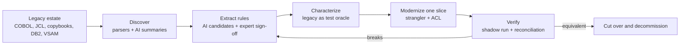

# Banking modernization with AI


[](LICENSE) [](docs/banking-modernization-with-ai-context.md) [](docs/banking-modernization-with-ai-context.md) [](docs/banking-modernization-with-ai-context.md) [](docs/banking-modernization-with-ai-context.md#4-where-ai-helps) [](https://eur-lex.europa.eu/eli/reg/2022/2554/oj) [](examples/java)

The idea: modernizing a bank's legacy core is not a COBOL-to-Java translation job. The hard part is the knowledge buried in the code: decades of interest, fee, rounding, eligibility and reconciliation rules, batch cycles nobody fully remembers, and data formats that break naive conversions. Rewrite before you understand, and you replace a reliable system with a less reliable one.

This repository describes a different approach. A solution architect turns the undocumented legacy estate into business capabilities that can be understood, tested and modernized one slice at a time. AI speeds up the slow parts (discovery, rule extraction, test generation, discrepancy analysis), while deterministic tooling and people keep the authority over financial correctness. It is written as a context file: something to read before a planning session, and something to hand to an AI assistant before asking it about a modernization initiative.

It is the companion to [legacy-modernization-patterns](https://github.com/wallaceespindola/legacy-modernization-patterns). That repository catalogs the migration patterns (Strangler Fig, ACL, CDC, Parallel Run and the rest). This one covers the people and process side: what makes banking modernization hard, what the architect owns, where AI fits, and how to run a first 90-day initiative.

## Why

Banks keep mainframes running for good reasons: they are fast, stable and audited. What erodes over time is everything around them. The engineers who know the business rules are retiring, and the rules were never written down outside the code. Every change is slow and risky because tests are thin and dependencies hide in shared copybooks, files and job schedules. Customer channels expect real-time behavior from systems designed around overnight batch. And regulators, DORA in particular, expect operational resilience and control over third parties, including cloud and AI providers.

Big-bang rewrites have a poor track record in this setting. AI makes a faster rewrite tempting, but the bottleneck was never typing speed. It was understanding. Used well, AI shortens the time it takes to understand a legacy system. Used badly, it produces confident translations of rules nobody checked.

## Context summary

**Main difficulties**

- **People and organization:** scarce mainframe and COBOL skills, rules known only by a few specialists, siloed teams and an org chart that mirrors the monolith.
- **Technology:** large coupled applications, business rules embedded in code, thin tests, CICS/IMS, JCL and schedulers, dead and duplicated code.
- **Architecture and integration:** monolithic boundaries, links to payments, cards, risk, fraud and reporting, and overnight batch coexisting with real-time channels.
- **Data and correctness:** DB2, VSAM and packed decimal, rounding and precision, encoding, dates, synchronization during coexistence, and the need for authoritative ledgers and reconciliation.
- **Risk, governance and cost:** availability, security and traceability, DORA and related regulation, double-run cost, and the risk of replacing a reliable workload with a less reliable one.

**Where the solution architect helps:** reconstruct the current state, define capabilities and domain boundaries with experts, set target and transition architectures, choose consistency models and non-functional targets, plan incremental waves by value and risk, govern quality gates (equivalence, reconciliation, rollback), and document decisions and trade-offs.

**Where AI helps:** legacy discovery, business-rule extraction with source traceability, architecture reconstruction, domain modeling, code modernization, data mapping, characterization tests and discrepancy analysis, knowledge transfer and prioritization. Every use case comes with a control.

**Guardrail:** AI must not independently approve banking correctness. Deterministic parsers and static analysis come first, and human review, the legacy system as test oracle, financial reconciliation and secure model deployment are required.

**90-day initiative**

| Phase | Focus |
| --- | --- |
| Days 1–30 | Select a bounded capability, inventory programs and dependencies, capture risks, set baseline metrics |
| Days 31–60 | AI-assisted discovery proof of concept, rule catalog, data and service boundaries, characterization tests |
| Days 61–90 | One controlled modernization slice in shadow mode, reconciliation against legacy, target architecture and roadmap |

**Success measures:** discovery effort, business rules validated, dependency coverage, characterization coverage, reconciliation discrepancies, defect escape rate, change lead time, operational resilience, cost and business value.

**Key message:** the greatest opportunity for a solution architect using AI is to turn undocumented legacy banking systems into understandable, testable and incrementally modernizable business capabilities, while preserving financial correctness and operational risk controls.

## Core principles

| Principle | What it means in practice |
| --- | --- |
| Modernize capabilities, not code | The unit of change is a business capability such as fee calculation or statements, not a program or a language |
| Correctness is proven, not assumed | Characterization tests, parallel runs and ledger-level reconciliation decide when a slice is done |
| AI proposes, deterministic tooling verifies, humans approve | AI shortens the work; it never becomes the authority on financial behavior |
| Decommission, don't just build | Every slice has a date when the legacy part is switched off, or the bank pays for two platforms indefinitely |



In short: parsers and static analysis map the estate, AI turns that map into readable summaries and candidate rules, domain experts sign the rules off, the legacy system acts as the test oracle, and reconciliation decides when a slice is actually done.

## What's in the context file

[`docs/banking-modernization-with-ai-context.md`](docs/banking-modernization-with-ai-context.md) contains:

- The main difficulties in detail, with the mainframe specifics that generic lists leave out: `COMP-3` and `REDEFINES`, EBCDIC collation, COBOL vs Java rounding, Julian dates and batch restart semantics
- Six modernization strategies (retain, rehost, refactor, rearchitect, replace, retire) with fit and risk for each, and the recommended incremental strangler with controlled coexistence
- What a solution architect owns, plus the architecture anti-patterns to prevent
- Where AI helps, each use case paired with the control it needs, a reference AI-assisted discovery pipeline, and AI governance: deployment, data masking, prompt injection, reproducibility and accountability
- A testing and verification strategy: golden master, record and replay, differential and property-based testing, three-level reconciliation and parallel runs
- The 90-day initiative with criteria for choosing the first capability and exit criteria for each phase
- Success measures with how to measure each one, and the open questions to settle early
- The regulatory frame to check per institution: DORA, EBA guidelines, BCBS 239, GDPR, PSD2 and the EU AI Act

## How to use it

- **Planning:** start from the 90-day initiative, pick a capability with the selection criteria, and use the exit criteria as phase gates.
- **Design reviews:** use the difficulties, anti-patterns and open questions as a checklist for a modernization proposal.
- **AI adoption:** use the AI table and governance section to agree with security and risk which use cases are allowed and which controls apply, before any tool reaches the code.
- **With an AI assistant:** load the file as context (for example, reference it from a `CLAUDE.md` or `.github/copilot-instructions.md`) before asking for discovery plans, ADRs or migration roadmaps. The assistant then starts from the same vocabulary and guardrails.
- **Writing:** it is the source material for articles and talks on the topic.

## Runnable example

The context says correctness must be proven, so the repo includes one small proof. `examples/cobol/INTCALC.cbl` holds an illustrative interest rule: a `COMPUTE` with no `ROUNDED` phrase, which truncates to two decimals. `examples/java/` ports it to Java 21 and proves the port against a golden master:

- `PackedDecimal` decodes `COMP-3` fields, including sign-nibble validation.
- `InterestRule` is the legacy-equivalent port (`RoundingMode.DOWN`), next to a naive port with banker's rounding that a reviewer could easily accept.
- `Reconciler` compares legacy and modern results per account with zero tolerance.
- `InterestRuleGoldenMasterTest` shows the correct port reconciling and the naive one breaking on 3 of 8 accounts by one cent.

The golden CSV is an illustrative fixture worked out by hand from the COBOL semantics, not data from a real bank. The matching rule catalog entry is in [`docs/templates/rule-catalog-entry.md`](docs/templates/rule-catalog-entry.md).

```bash
make test   # or: cd examples/java && mvn -q test
```

## Related reading

My articles on the same topic:

- [Stop Rewriting Legacy Systems: Use AI to Understand Them First](https://dev.to/wallaceespindola/stop-rewriting-legacy-systems-use-ai-to-understand-them-first-21ba) (Dev.to)
- [Above the Rewrite: How AI Is Changing Legacy Modernization](https://medium.com/@wallaceespindola/above-the-rewrite-how-ai-is-changing-legacy-modernization-ed757a9087a3) (Medium)
- [The Future of Legacy Modernization Isn't a Simple Rewrite](https://wallaceespindola.substack.com/p/the-future-of-legacy-modernization) (Code & Coffee, Substack)

External references:

- [Regulation (EU) 2022/2554 (DORA)](https://eur-lex.europa.eu/eli/reg/2022/2554/oj)
- [Strangler Fig Application, Martin Fowler](https://martinfowler.com/bliki/StranglerFigApplication.html)
- [Working Effectively with Legacy Code, Michael Feathers](https://www.oreilly.com/library/view/working-effectively-with/0131177052/) (characterization tests)

## Repository layout

| Path | Contents |
| --- | --- |
| `docs/banking-modernization-with-ai-context.md` | The modernization context |
| `docs/templates/rule-catalog-entry.md` | Rule catalog template with the BR-INT-001 worked example |
| `docs/diagrams/` | Mermaid sources and rendered PNGs |
| `docs/articles/` | Platform article drafts, banners and diagrams |
| `docs/presentations/` | Talk deck (Marp source, PDF, PPTX) and import guide |
| `examples/cobol/` | Illustrative COBOL program and copybook |
| `examples/java/` | Java 21 port, golden-master tests and reconciler |
| `docs/images/banner.png` | README banner |
| `Makefile` | `make diagrams`, `format`, `lint`, `links`, `slides`, `test` |

## Support

If you find this project helpful, please consider:

[](https://www.buymeacoffee.com/wallace.espindola) [](https://github.com/wallaceespindola/banking-modernization-with-ai)

[](https://github.com/wallaceespindola/banking-modernization-with-ai/stargazers) [](https://github.com/wallaceespindola/banking-modernization-with-ai/network/members) [](https://github.com/wallaceespindola/banking-modernization-with-ai/watchers) [](https://github.com/wallaceespindola/banking-modernization-with-ai/issues) [](https://github.com/wallaceespindola/banking-modernization-with-ai/commits/main)

Star the repo on GitHub if it helps your modernization work. It motivates me a lot!

## Author

Wallace Espindola, Solution Architect

- Email: <wallace.espindola@gmail.com>
- LinkedIn: <https://www.linkedin.com/in/wallaceespindola/>
- GitHub: <https://github.com/wallaceespindola/>
- Twitter/X: [@wsespindola](https://x.com/wsespindola)
- Substack: [Code & Coffee by Wallace Espindola](https://wallaceespindola.substack.com)
- Medium: <https://medium.com/@wallaceespindola>
- Dev.to: <https://dev.to/wallaceespindola>
- DZone: <https://dzone.com/users/1254611/wallacese.html>
- Speaker Deck: <https://speakerdeck.com/wallacese>
- Speaker profile: <https://sessionize.com/wallace-espindola/>
- Company: [www.wtechitsolutions.com](http://www.wtechitsolutions.com)
- Buy Me a Coffee: <https://www.buymeacoffee.com/wallace.espindola>

## License

[Apache 2.0](LICENSE)
