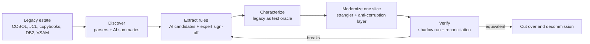

# Banking Modernization with AI


[](LICENSE)
[](docs/context.md)
[](docs/context.md#recommended-pattern-incremental-strangler-with-controlled-coexistence)
[](docs/context.md)
[](https://eur-lex.europa.eu/eli/reg/2022/2554/oj)

The idea: modernizing a bank's legacy core is not a COBOL-to-Java translation job. The hard part is the knowledge buried
in the code: decades of interest, fee, rounding, eligibility and reconciliation rules, batch cycles nobody fully
remembers, and data formats that break naive conversions. Rewrite before you understand, and you replace a reliable
system with a less reliable one.

This repository is the shared context for a different approach. A Solution Architect turns the undocumented legacy
estate into business capabilities that can be understood, tested and modernized one slice at a time. AI speeds up the
slow parts (discovery, rule extraction, test generation, discrepancy analysis), while deterministic tooling and people
keep the authority over financial correctness.

## Why

Banks keep mainframes running for good reasons: they are fast, stable and audited. What erodes over time is everything
around them:

- The engineers who know the business rules are retiring, and the rules were never written down outside the code.
- Every change is slow and risky because tests are thin and dependencies are hidden in shared copybooks, files and job
  schedules.
- Customer channels expect real-time behavior from systems designed around overnight batch.
- Regulators, DORA in particular, expect operational resilience and third-party risk control, including for cloud and AI
  providers.

Big-bang rewrites have a poor track record in this setting. An incremental, evidence-based approach, where each slice
proves equivalence against the legacy system before it takes traffic, is slower to start and much safer to finish.

## Core principles

1. **Modernize capabilities, not code.** The unit of change is a business capability such as fee calculation or
   statements, not a program or a language.
2. **Correctness is proven, not assumed.** Characterization tests, parallel runs and ledger-level reconciliation decide
   when a slice is done.
3. **AI proposes, deterministic tooling verifies, humans approve.** AI shortens the work. It never becomes the authority
   on financial behavior.

## How it works



The full reasoning, with strategy options, AI controls, testing approach, a 90-day plan and success measures, is in
[`docs/context.md`](docs/context.md).

## What's inside

| Document                             | What it covers                                                                     |
| ------------------------------------ | ---------------------------------------------------------------------------------- |
| [`docs/context.md`](docs/context.md) | Shared context: difficulties, strategy options, architect and AI roles, guardrails |
|                                      | AI governance and security, testing and verification, 90-day initiative, KPIs      |
| [`docs/images/`](docs/images/)       | Project banner                                                                     |

Main sections of the context document:

- [Main difficulties](docs/context.md#1-main-difficulties): people, technology, integration, data correctness, risk and
  cost.
- [Modernization strategy options](docs/context.md#2-modernization-strategy-options): retain, rehost, refactor,
  rearchitect, replace, retire, and the recommended strangler pattern.
- [Where the Solution Architect helps](docs/context.md#3-where-the-solution-architect-helps), including anti-patterns to
  prevent.
- [Where AI helps](docs/context.md#4-where-ai-helps): use cases with the control each one needs, a reference discovery
  pipeline and AI governance.
- [Testing and verification strategy](docs/context.md#5-testing-and-verification-strategy).
- [Suggested 90-day initiative](docs/context.md#6-suggested-incremental-initiative-90-days) with exit criteria.
- [Success measures](docs/context.md#7-success-measures) and
  [open questions](docs/context.md#8-open-questions-to-resolve-early).

## Who this is for

- Solution and enterprise architects planning a mainframe or core banking modernization.
- Engineering leads who need to introduce AI into legacy work without losing control of correctness.
- Risk, compliance and operations stakeholders who want to see where the controls sit.

## Repository structure

```text
banking-modernization-with-ai/
├── README.md                  This file
├── Makefile                   format, lint and link-check targets
├── LICENSE                    Apache 2.0
└── docs/
    ├── context.md             Shared modernization context
    └── images/banner.png      Project banner
```

## Working with the docs

```bash
make format   # Prettier, 120-char prose wrap
make lint     # markdownlint-cli2
make links    # lychee offline link check (needs lychee installed)
make check    # lint + links
```

Diagrams are Mermaid blocks inside the Markdown, so GitHub renders them directly.

## Related reading

My articles and talks on the same topic:

- [Stop Rewriting Legacy Systems: Use AI to Understand Them First](https://dev.to/wallaceespindola/stop-rewriting-legacy-systems-use-ai-to-understand-them-first-21ba)
  (Dev.to)
- [Above the Rewrite: How AI Is Changing Legacy Modernization](https://medium.com/@wallaceespindola/above-the-rewrite-how-ai-is-changing-legacy-modernization-ed757a9087a3)
  (Medium)
- [The Future of Legacy Modernization Isn't a Simple Rewrite](https://wallaceespindola.substack.com/p/the-future-of-legacy-modernization)
  (Code & Coffee, Substack)
- [Legacy modernization patterns](https://github.com/wallaceespindola/legacy-modernization-patterns) (companion repo)

External references:

- [Regulation (EU) 2022/2554 (DORA)](https://eur-lex.europa.eu/eli/reg/2022/2554/oj)
- [Strangler Fig Application, Martin Fowler](https://martinfowler.com/bliki/StranglerFigApplication.html)
- [Working Effectively with Legacy Code, Michael Feathers](https://www.oreilly.com/library/view/working-effectively-with/0131177052/)
  (characterization tests)

## Support

If you find this project helpful, please consider:

[](https://www.buymeacoffee.com/wallace.espindola)
[](https://github.com/wallaceespindola/banking-modernization-with-ai)

[](https://github.com/wallaceespindola/banking-modernization-with-ai/stargazers)
[](https://github.com/wallaceespindola/banking-modernization-with-ai/network/members)
[](https://github.com/wallaceespindola/banking-modernization-with-ai/watchers)
[](https://github.com/wallaceespindola/banking-modernization-with-ai/issues)
[](https://github.com/wallaceespindola/banking-modernization-with-ai/commits/main)

Star the repo on GitHub if it helps your modernization work. It motivates me a lot!

## Author

Wallace Espindola, Solution Architect

- Email: <wallace.espindola@gmail.com>
- LinkedIn: <https://www.linkedin.com/in/wallaceespindola/>
- GitHub: <https://github.com/wallaceespindola/>
- Twitter/X: [@wsespindola](https://x.com/wsespindola)
- Substack: [Code & Coffee by Wallace Espindola](https://wallaceespindola.substack.com)
- Medium: <https://medium.com/@wallaceespindola>
- Dev.to: <https://dev.to/wallaceespindola>
- DZone: <https://dzone.com/users/1254611/wallacese.html>
- Speaker Deck: <https://speakerdeck.com/wallacese>
- Speaker profile: <https://sessionize.com/wallace-espindola/>
- Company: [www.wtechitsolutions.com](http://www.wtechitsolutions.com)
- Buy Me a Coffee: <https://www.buymeacoffee.com/wallace.espindola>

## License

- This project is released under the Apache 2.0 License.
- See the [LICENSE](LICENSE) file for details.
- Copyright © 2026 [Wallace Espindola](https://github.com/wallaceespindola/).
