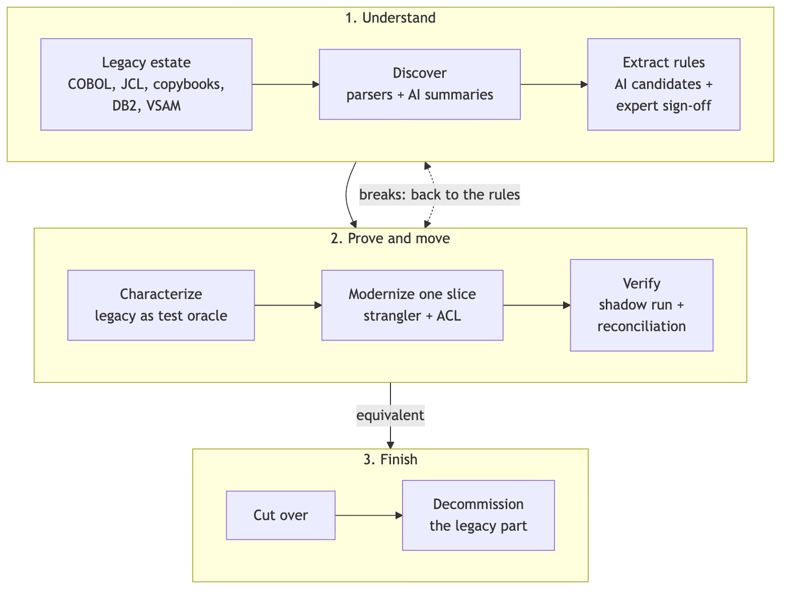

You've been asked to move a bank's monthly interest calculation off the mainframe. The COBOL program is short, the logic looks like one line of arithmetic, and someone on the team has already said "we can port that in an afternoon". They're right about the afternoon. The port will compile, the unit tests you write for it will pass, and it will still be off by a cent on some accounts.

That cent sums up the trouble with legacy banking code. The rules live in the code rather than in a document, and the code carries semantics (truncation, packed decimal, implied decimal points) that a reasonable-looking Java port changes without anyone noticing. So before you port anything, you pin down what the legacy system actually does and make it the judge.

This article covers the hands-on part: the files you read, the files you add and the commands you run to put one COBOL rule under characterization tests, port it to Java 21 and prove the port is equivalent. Everything is in the companion repo, [banking-modernization-with-ai on GitHub](https://github.com/wallaceespindola/banking-modernization-with-ai). The COBOL in there is illustrative (it isn't compiled), and the Java module is real and runs with `make test`.



The diagram is the whole loop the repo describes. This article lives in the middle of it: extract one rule, characterize it, port it, verify it.

## What's in the repo

These are the files you'll touch, in the order you'll touch them:

```text
examples/cobol/
  ACCTREC.cpy                       # account record layout (copybook)
  INTCALC.cbl                       # monthly interest, rule BR-INT-001
docs/templates/
  rule-catalog-entry.md             # catalog template + BR-INT-001 entry
examples/java/src/main/java/com/wtechitsolutions/bankingmodernization/
  PackedDecimal.java                # COMP-3 decoder
  InterestRule.java                 # legacy-equivalent port + naive port
  Reconciler.java                   # zero-tolerance, per-account compare
examples/java/src/test/
  java/.../InterestRuleGoldenMasterTest.java
  resources/golden/monthly-interest.csv
```

You need Java 21 and Maven for the Java part. Nothing else.

## Step 1: read the copybook before the program

Start with the copybook, not the program. In COBOL, the copybook is the data contract, and it's usually shared. The header comment in `ACCTREC.cpy` says it plainly: changing it is an interface change for every program that `COPY`s it. Here are the fields that matter for interest:

```cobol
       01  ACCT-REC.
           05  ACCT-ID                 PIC X(8).
           05  ACCT-STATUS             PIC X(1).
               88  ACCT-ACTIVE                   VALUE 'A'.
               88  ACCT-CLOSED                   VALUE 'C'.
           05  ACCT-BALANCE            PIC S9(11)V99 COMP-3.
           05  ACCT-ANNUAL-RATE        PIC S9(3)V99  COMP-3.
           05  ACCT-OPEN-DATE          PIC 9(7).
      *        Julian date CCYYDDD
```

Three things in there will bite a naive port. `S9(11)V99` means signed, eleven integer digits and two decimals, but the `V` is an implied decimal point: it isn't stored anywhere in the bytes. `COMP-3` means packed decimal, so you can't read the field as text. And the open date is a Julian `CCYYDDD`, which isn't used by this rule but will be by the next one. (The 88-levels are named conditions, so `IF ACCT-ACTIVE` in the program means `ACCT-STATUS = 'A'`.)

Now the program. The rule itself is one statement in paragraph `2000-CALC-INTEREST` of `INTCALC.cbl`:

```cobol
       2000-CALC-INTEREST.
           IF ACCT-ACTIVE
      *        No ROUNDED phrase: the result is truncated to two decimals.
               COMPUTE WS-MONTHLY-INT =
                   ACCT-BALANCE * ACCT-ANNUAL-RATE / 1200
           ELSE
               MOVE ZERO TO WS-MONTHLY-INT
           END-IF.
```

The detail you're looking for is what's missing. There's no `ROUNDED` phrase on the `COMPUTE`, so COBOL truncates the result to the two decimals of the receiving field `WS-MONTHLY-INT PIC S9(11)V99`. Truncation goes toward zero, which matters for negative balances. A real legacy program wouldn't have that helpful comment, which is why you read the statement and not the comments.

## Step 2: decode COMP-3 into BigDecimal

You can't compare legacy and modern results until you can read the legacy data. Packed decimal stores two digits per byte, one per nibble, and the last nibble is the sign: `C` for positive, `D` for negative, `F` for unsigned. The scale isn't in the bytes at all. It comes from the `PIC` clause, so `PIC S9(3)V99 COMP-3` has scale 2 and the value +123.45 is stored as `12 34 5C`.

Here is the decoder, trimmed from `PackedDecimal.java` in the repo:

```java
public static BigDecimal decode(byte[] field, int scale) {
    if (field == null || field.length == 0) {
        throw new IllegalArgumentException("Packed decimal field is empty");
    }
    StringBuilder digits = new StringBuilder(field.length * 2);
    for (int i = 0; i < field.length; i++) {
        int high = (field[i] >> 4) & 0x0F;
        int low = field[i] & 0x0F;
        digits.append(digit(high, i));
        if (i < field.length - 1) {
            digits.append(digit(low, i));
        } else {
            return signed(new BigInteger(digits.toString()), low).movePointLeft(scale).setScale(scale);
        }
    }
    throw new IllegalStateException("unreachable");
}
```

Two choices in there are deliberate. The caller passes the scale, because only the copybook knows it. And the decoder throws on a digit nibble above 9 or an unknown sign nibble instead of guessing, because a corrupt field should stop a migration run, not turn into a plausible number. `PackedDecimalTest` covers positive, negative, unsigned (`05 0F` with scale 2 is `0.50`) and both invalid cases.

## Step 3: write the rule catalog entry

Before any Java, write down the rule in a form a domain expert can confirm. The repo has a template in `docs/templates/rule-catalog-entry.md` and a filled-in entry for this rule. Trimmed from the repo:

```markdown
## BR-INT-001: Monthly interest accrual

- Status: validated
- Capability: Interest accrual
- Source: `examples/cobol/INTCALC.cbl`, paragraph `2000-CALC-INTEREST`; copybook `examples/cobol/ACCTREC.cpy`
- Plain-language rule: for an active account, monthly interest is the balance times the annual rate in percent, divided by 1200. Closed accounts accrue nothing.
- Inputs: `ACCT-BALANCE PIC S9(11)V99 COMP-3`, `ACCT-ANNUAL-RATE PIC S9(3)V99 COMP-3`, `ACCT-STATUS PIC X(1)`
- Output: `WS-MONTHLY-INT PIC S9(11)V99 COMP-3`
- Arithmetic: no `ROUNDED` phrase, so the result is truncated toward zero to two decimals. Intermediate precision depends on compiler options and is pinned by the characterization tests.
- Edge cases: negative balances (overdraft interest, truncated toward zero), zero balance, sub-cent results, maximum balance
- Characterization tests: `examples/java/src/test/java/com/wtechitsolutions/bankingmodernization/InterestRuleGoldenMasterTest.java`, data in `examples/java/src/test/resources/golden/monthly-interest.csv`
- Modern implementation: `examples/java/src/main/java/com/wtechitsolutions/bankingmodernization/InterestRule.java`
```

The Arithmetic line is the one that saves you. It turns "the code divides by 1200" into "the code truncates toward zero to two decimals", which is a statement someone can agree or disagree with. The Edge cases line drives the test data in the next step.

This is also where AI is most useful in the workflow. An assistant can read the program and draft this entry quickly, with the source link and paragraph or line range. It can't approve it. The template keeps a status field (candidate, in review, validated, rejected) and an "Approved by" field for a reason: AI proposes, a named domain expert signs off, and the entry isn't done until it links to the tests that prove the port matches.

## Step 4: capture the golden master

A golden master (or characterization test, in Michael Feathers' terms from [Working Effectively with Legacy Code](https://www.oreilly.com/library/view/working-effectively-with/0131177052/)) records what the legacy system outputs for a set of inputs, without judging whether it's right. The legacy system is the test oracle, and it outranks the spec, the model and your own reading of the code.

In a real migration you'd run the legacy batch against representative and edge-case inputs (masked, never raw production data) and save the outputs. The repo can't do that, so its CSV is an illustrative fixture worked out by hand from the COBOL semantics, not captured from a real bank. Here it is, `src/test/resources/golden/monthly-interest.csv`:

```csv
account,balance,annual_rate_percent,legacy_monthly_interest
ACC-0001,1000.00,5.00,4.16
ACC-0002,2500.00,3.75,7.81
ACC-0003,1234.56,2.50,2.57
ACC-0004,999999.99,4.10,3416.66
ACC-0005,0.01,5.00,0.00
ACC-0006,-150.00,18.00,-2.25
ACC-0007,-100.00,19.99,-1.66
ACC-0008,0.00,7.25,0.00
```

Most rows map to an edge case from the catalog entry: a sub-cent result (`ACC-0005`), a zero balance (`ACC-0008`), a large balance (`ACC-0004`) and two overdrafts (`ACC-0006`, `ACC-0007`). The others (`ACC-0001`, `ACC-0002`, `ACC-0003`) are baseline cases. Look at `ACC-0001`: 1000.00 times 5.00 divided by 1200 is 4.1666..., and truncation makes the legacy answer 4.16 where rounding would give 4.17.

## Step 5: port the rule with the right RoundingMode

Now you write Java. Money is `BigDecimal` with an explicit scale and an explicit `RoundingMode`, never `double`. `InterestRule.java` holds two versions of the rule on purpose:

```java
/** Legacy-equivalent result: truncation toward zero, like COBOL without {@code ROUNDED}. */
public static BigDecimal monthlyInterest(BigDecimal balance, BigDecimal annualRatePercent) {
    // One division on an exact product. If the compiler used a smaller intermediate precision
    // (ARITH option), pin that from the characterization tests before changing this line.
    return balance.multiply(annualRatePercent).divide(MONTHS_TIMES_PERCENT, MONEY_SCALE, RoundingMode.DOWN);
}

/** The port a reviewer would accept at first glance: banker's rounding. Kept to show the break. */
public static BigDecimal monthlyInterestNaivePort(BigDecimal balance, BigDecimal annualRatePercent) {
    return balance.multiply(annualRatePercent).divide(MONTHS_TIMES_PERCENT, MONEY_SCALE, RoundingMode.HALF_EVEN);
}
```

`RoundingMode.DOWN` in Java rounds toward zero, which matches COBOL truncation for both positive and negative values. (`FLOOR` would not: it turns -1.6658... into -1.67.) `MONTHS_TIMES_PERCENT` is `1200` and `MONEY_SCALE` is `2`, so the scale of the receiving field is explicit in the code, just like the `PIC` clause.

The naive port uses `HALF_EVEN`, banker's rounding. It isn't a silly choice. It reads as more "correct" than truncation, and a reviewer could easily approve it, which is why the repo keeps it.

## Step 6: reconcile against the golden master

A test that compares one value at a time tells you a row failed. A reconciler tells you which accounts broke, by how much and whether the totals agree. That's the shape of the report a business owner will read: `Reconciler.Report` carries the breaks plus `legacyTotal` and `modernTotal`, and it only counts as equivalent when there are no breaks and the totals match. `Reconciler.java` compares legacy and modern results per account with zero tolerance. The core loop, trimmed from the repo:

```java
for (String account : accounts) {
    BigDecimal l = legacy.get(account);
    BigDecimal m = modern.get(account);
    if (l == null) {
        breaks.add(new Break(account, null, m, "missing in legacy"));
    } else if (m == null) {
        breaks.add(new Break(account, l, null, "missing in modern"));
    } else if (l.compareTo(m) != 0) {
        breaks.add(new Break(account, l, m, "amount differs by " + m.subtract(l).toPlainString()));
    }
}
```

It uses `compareTo`, not `equals`, because `BigDecimal.equals` treats `10.0` and `10.00` as different. An account present on only one side is a break too. A missing record is a worse problem than a wrong cent.

The golden-master test ties it together. Trimmed from `InterestRuleGoldenMasterTest.java`:

```java
@ParameterizedTest(name = "{0}: {1} at {2}% -> {3}")
@CsvFileSource(resources = GOLDEN, numLinesToSkip = 1)
void matchesLegacyOutputToTheCent(String account, BigDecimal balance, BigDecimal rate, BigDecimal expected) {
    assertEquals(expected, InterestRule.monthlyInterest(balance, rate), account);
}

@Test
void portReconcilesWithLegacyRun() {
    Reconciler.Report report = reconcileAgainstGolden(InterestRule::monthlyInterest);

    assertTrue(report.equivalent(), () -> "Breaks: " + report.breaks());
}

@Test
void naivePortWithBankersRoundingProducesBreaks() {
    Reconciler.Report report = reconcileAgainstGolden(InterestRule::monthlyInterestNaivePort);

    assertFalse(report.equivalent());
    assertEquals(List.of("ACC-0001", "ACC-0004", "ACC-0007"), report.breaks().stream().map(Reconciler.Break::accountId).toList());
}
```

The parameterized test runs once per CSV row, so each account shows up by name in the test report. The other two tests run the whole file through the reconciler, once with the real port and once with the naive one.

Here's the loop those tests implement:


Follow the dotted arrow when the reconciler reports a break. You don't patch the Java until the numbers match. You go back to the catalog entry, find out which rule you misunderstood, get it confirmed and then fix the port.

## Step 7: run it and watch the naive port fail

From the repo root:

```bash
make test
```

That runs `mvn -q test` in `examples/java`, so it's quiet when everything passes. Run Maven without `-q` to see the counts. Trimmed Surefire output:

```bash
cd examples/java && mvn test
```

```text
[INFO] Tests run: 5, Failures: 0, Errors: 0, Skipped: 0, ... in com.wtechitsolutions.bankingmodernization.PackedDecimalTest
[INFO] Tests run: 2, Failures: 0, Errors: 0, Skipped: 0, ... in com.wtechitsolutions.bankingmodernization.ReconcilerTest
[INFO] Tests run: 10, Failures: 0, Errors: 0, Skipped: 0, ... in com.wtechitsolutions.bankingmodernization.InterestRuleGoldenMasterTest
[INFO] Tests run: 17, Failures: 0, Errors: 0, Skipped: 0
[INFO] BUILD SUCCESS
```

All 17 pass, and one of them passes because the naive port fails. With `HALF_EVEN`, three of the eight accounts break:

| Account | Legacy | Naive port |
| --- | --- | --- |
| ACC-0001 | 4.16 | 4.17 |
| ACC-0004 | 3416.66 | 3416.67 |
| ACC-0007 | -1.66 | -1.67 |

Each break is one cent, on a fixture of eight rows. Across a real portfolio and a monthly cycle, that's the kind of difference that turns up in a ledger reconciliation weeks after go-live, when it's much harder to explain. If you want to see it fail in the other direction, change `RoundingMode.DOWN` to `HALF_EVEN` in `monthlyInterest` and run the tests again: `matchesLegacyOutputToTheCent` and `portReconcilesWithLegacyRun` go red with the same three accounts.

## Things that will trip you up

**Intermediate precision.** The Java port computes the exact product and does one division. A COBOL compiler can carry a different intermediate precision depending on its options (the comment in the repo calls it the `ARITH` option). The catalog entry says that precision is pinned by the characterization tests, and the comment in `InterestRule` says the same: if real legacy outputs disagree with the exact calculation, the golden master wins and you change the Java to match.

**Hand-made golden data.** The repo's CSV was worked out by hand, which is fine for showing the technique and not fine for a migration. In real work the golden master comes from running the legacy system, on masked inputs, and it covers month-end and the edge cases the domain expert names.

**Copybooks beyond this one.** `ACCTREC.cpy` is deliberately simple. Real ones bring `REDEFINES`, `OCCURS DEPENDING ON`, signed zoned decimal and EBCDIC collation that sorts differently from ASCII. Each one needs its own decoder and its own tests before you trust a comparison.

**Equals on BigDecimal.** Using `equals` instead of `compareTo` is an easy way to make a reconciler report breaks that aren't there. `ReconcilerTest.equalAmountsWithDifferentScaleAreNotABreak` is there to keep it honest.

## Where it doesn't pay off

Characterization tests cost something: you need access to the legacy system to run it, masked test data, a domain expert's time for the catalog entry and someone who can read COBOL well enough to spot a missing `ROUNDED`. For one rule that's manageable. Across a whole estate it's a large share of the work, so plan for it.

They also don't tell you the legacy behavior is right. A golden master pins what the system does, bugs included. If the expert looks at the overdraft rows and says "that was never intended", you've found a business decision, and someone has to own the change.

And they don't cover everything. A per-record golden master won't catch batch semantics like checkpoint and restart, cut-off times or "exactly once per business date". Those need record-and-replay, parallel runs over at least one full business cycle and reconciliation at the account and general-ledger level, which the [context file in the repo](https://github.com/wallaceespindola/banking-modernization-with-ai/blob/main/docs/banking-modernization-with-ai-context.md) lays out in its testing section. For a rule that will be retired instead of ported, skip all of this.

## Recap

- Read the copybook first. `PIC S9(11)V99 COMP-3` tells you the sign, the scale and the storage format, none of which are in the bytes as text.
- Decode `COMP-3` with the scale from the `PIC` clause, and fail loudly on bad nibbles.
- Write the rule catalog entry before the code, with the arithmetic spelled out. AI can draft it, an expert approves it.
- Capture the golden master from the legacy system and treat it as the oracle.
- Port with `BigDecimal` and the `RoundingMode` the legacy code implies: `DOWN` for COBOL without `ROUNDED`.
- Reconcile per account with zero tolerance, and send breaks back to the catalog entry.

## Try it yourself

Clone [the repo](https://github.com/wallaceespindola/banking-modernization-with-ai), run `make test`, then flip the `RoundingMode` in `InterestRule.monthlyInterest` and watch the reconciler name the three accounts. After that, add a row to `monthly-interest.csv` for a case the fixture doesn't cover (a closed account, or the maximum balance `PIC S9(11)V99` allows), work out the legacy answer from the COBOL semantics and see whether the port agrees.

Which COBOL arithmetic detail has caught you out in a port, rounding, intermediate precision or something in a copybook? I'd like to hear in the comments.

*I wrote this article with AI assistance, then reviewed, fact-checked and edited it myself.*

**Examples repository:** every example in this article (the `ACCTREC` copybook, the `INTCALC` program, the BR-INT-001 catalog entry, the COMP-3 decoder, the interest rule and its naive port, the reconciler, the golden-master test and CSV and the diagrams) is in <https://github.com/wallaceespindola/banking-modernization-with-ai>.

Need more tech insights?\
Check out my GitHub, LinkedIn, and Speaker Deck.\
Happy coding!

Wallace Espindola, Solution Architect\
GitHub: <https://github.com/wallaceespindola/>\
LinkedIn: <https://www.linkedin.com/in/wallaceespindola/>\
Speaker Deck: <https://speakerdeck.com/wallacese>
