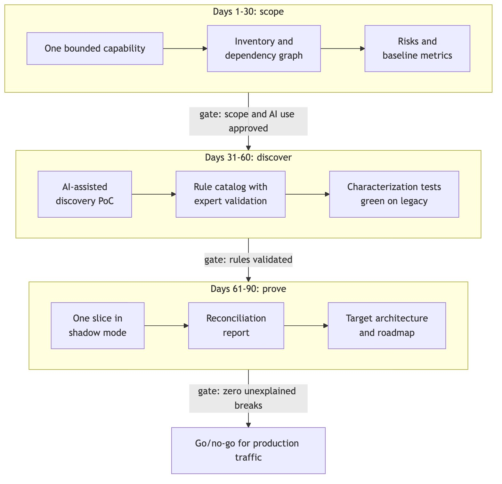
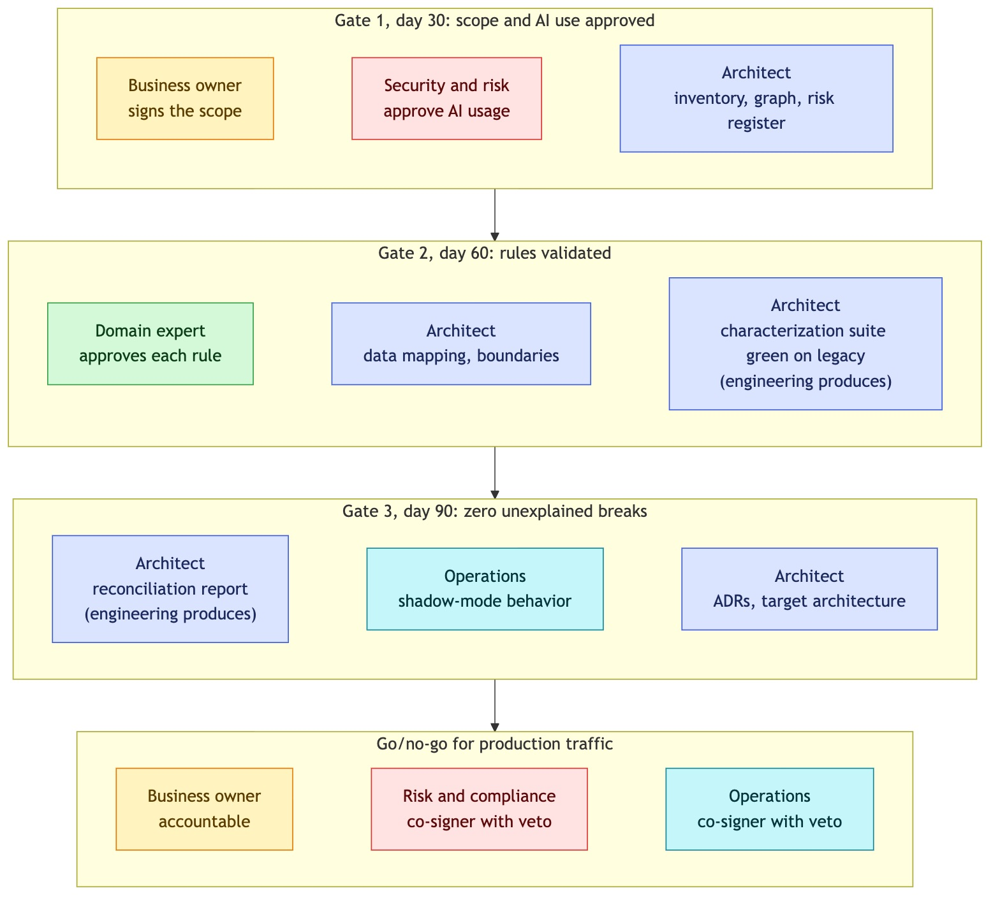
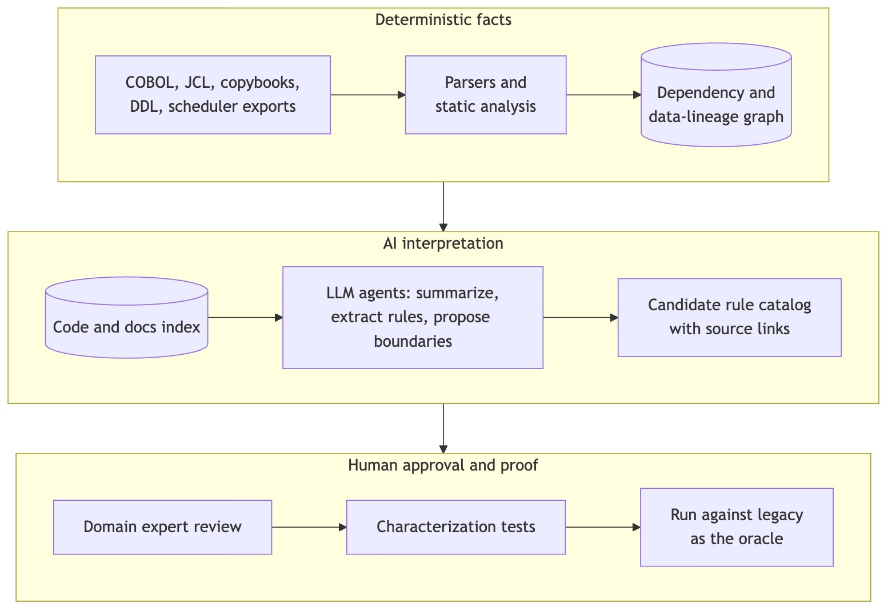

<!--
DZone submission metadata
TL;DR: A proposed operating model for AI-assisted core banking modernization: named owners, three quality gates, a required control for every AI use case and go/no-go criteria agreed before the slice is built.
Article type: Analysis
Summary (meta description): Who signs each gate when AI helps modernize a banking core: roles, exit criteria, AI controls, go/no-go rules and what to measure, as a proposed model.
Primary zone: Software Design and Architecture. Additional zones: AI, DevOps, Java, Testing.
Tags: legacy-modernization, core-banking, ai-governance, cobol, software-architecture, testing
-->
<!-- DZone rejects AI-written text: Wallace must write or fully rewrite this draft before submitting. -->

# AI in core banking modernization: governing the gates between legacy and new


**Author**: Wallace Espindola, Solution Architect
**Email**: <wallace.espindola@gmail.com>
**LinkedIn**: <https://www.linkedin.com/in/wallaceespindola/>
**GitHub**: <https://github.com/wallaceespindola/>
**Companion repo**: <https://github.com/wallaceespindola/banking-modernization-with-ai>

---

Core banking modernization tends to fail on governance before it fails on code. The COBOL can be read, parsed and ported. What goes wrong is that nobody agreed who decides a rule is correct, who signs off a difference of one cent, or who says the new service may take production traffic. Add AI to the discovery and implementation work and the question gets sharper, because the AI can produce plausible rule descriptions and plausible Java far faster than any review process was designed to absorb.

I wrote the process down as a [companion repository](https://github.com/wallaceespindola/banking-modernization-with-ai): a context document with the strategy, roles, 90-day plan and metrics, a rule catalog template with one worked entry, an illustrative COBOL program and copybook, and a small Java 21 module with a packed-decimal decoder, the legacy-equivalent interest rule, golden-master tests and a reconciler. This article covers the governance side: who owns what, which quality gates sit between the phases, which control each AI use case needs, which go/no-go criteria get agreed before anything is built, and what to measure. It is a proposed operating model. I don't have adoption numbers from a live programme, and I won't invent any.

## The model in one paragraph

The unit of change is a business capability (fees, statements, interest accrual), not a program or a language. A **solution architect** runs a 90-day initiative on one bounded capability in three phases: scope, discover, prove. Each phase ends at a gate with written exit criteria, and each gate has named signers. AI helps inside every phase, but under one rule that the whole model depends on: AI proposes, deterministic tooling verifies, humans approve. The legacy system is the test oracle. A slice only reaches production traffic after it has run in shadow mode and reconciled against the legacy output, using go/no-go criteria that were agreed before the slice was built.

Three principles from the context document frame everything below:

1. **Modernize capabilities, not code.** Line-by-line translation tends to produce "JOBOL": Java that keeps the COBOL structure, coupling and batch assumptions, with none of the benefits.
2. **Correctness is proven, not assumed.** Every slice demonstrates functional equivalence through characterization tests, parallel runs and ledger-level reconciliation.
3. **AI proposes, deterministic tooling verifies, humans approve.** AI shortens discovery and implementation. It never becomes the authority on financial behavior.

## Roles and responsibilities

A modernization slice touches business, risk, operations, security and engineering at once. If ownership isn't explicit, every failure ends in "I thought you checked that". I use six roles:

- **Business owner:** owns the capability, signs the scope and the business case, and is accountable for the final go/no-go decision.
- **Solution architect:** reconstructs the current state, defines boundaries and the target and transition architecture, chooses the consistency model per capability, records decisions as ADRs and governs the quality gates.
- **Domain expert:** the person who knows what the rule is supposed to do. Approves or rejects each candidate rule in the catalog.
- **Engineering:** builds the characterization suite, the slice and the reconciliation, and runs the AI-assisted tooling under the controls below.
- **Risk, compliance and security:** approve AI usage and hosting, own the regulatory evidence and agree the tolerance policy.
- **Operations:** own shadow-mode behavior, runbooks, failover and restart tests, and the batch window.

The table below turns that into a RACI matrix (Responsible, Accountable, Consulted, Informed) across the main activities of one initiative. The assignments are my proposal, derived from the responsibilities in the context document. Adjust them to your own governance structure, but keep one "A" per row. "C (veto)" marks a required co-signer: consulted, and able to block the decision.

| Activity | Business owner | Architect | Domain expert | Engineering | Risk and compliance | Operations |
| --- | --- | --- | --- | --- | --- | --- |
| Select the capability and sign the scope | A | R | C | C | C | C |
| Inventory, dependency graph, risk register | I | A | C | R | C | C |
| Approve AI models, hosting and data handling | I | C | | C | A/R | I |
| Extract candidate rules with AI | | A | C | R | | |
| Validate each rule in the catalog | I | C | A/R | C | | |
| Characterization suite green on legacy | | A | C | R | I | |
| Build the slice and run it in shadow mode | | A | C | R | I | C |
| Shadow-mode operational behavior (batch window, restart, duplicates) | | C | | R | I | A |
| Reconciliation report | C | A | C | R | C | I |
| Tolerance policy for differences | C | C | C | | A/R | |
| Go/no-go for production traffic | A | R | C | C | C (veto) | C (veto) |

Two rows deserve a comment. The domain expert is accountable for rule validation, not the architect and not the model that extracted the rule. If an AI-drafted rule is wrong and gets approved, the approval is the failure, so the approval has to sit with the person who can tell. The tolerance policy sits with risk and compliance because deciding whether a one-cent difference is acceptable is a control question. The context document lists "who signs it off?" as an open question to resolve early, and I'd rather answer it in week one than in week eleven.

## Three gates and their exit criteria

The 90-day plan has three phases, and the transition between them is where governance does its work. A phase is done when its exit criteria are met and signed, not when its calendar time runs out.



*Figure 1: The 90-day initiative and the gates between its phases.*

The exit criteria come straight from the plan:

| Phase | Activities | Exit criteria |
| --- | --- | --- |
| Days 1-30 | Select a bounded banking capability, inventory legacy programs and dependencies, capture risks, establish baseline metrics, interview domain experts. | Scope signed off; inventory and dependency graph; baseline metrics; risk register; AI usage approved by security and risk. |
| Days 31-60 | Build an AI-assisted discovery proof of concept, catalog candidate business rules, map data and service boundaries, produce characterization test cases. | Rule catalog with validation status; data mapping; characterization suite running against legacy; evaluation results for AI extraction. |
| Days 61-90 | Implement one controlled modernization slice, compare results against the legacy system, measure discrepancies and operational behavior, produce the target architecture and roadmap. | Slice running in shadow mode; reconciliation report; target and transition architecture; ADRs; prioritized roadmap with business case. |

Exit criteria only help if each one has a signer. Here's how I'd assign them:



*Figure 2: Who signs each gate. Proposed assignment.*

| Color | Role |
| --- | --- |
| Blue | Solution architect |
| Yellow | Business owner |
| Green | Domain expert |
| Red | Risk, compliance and security |
| Teal | Operations |

### Gate 1: scope and AI use approved

The first gate is about permission, in two senses. The business owner confirms the capability is "valuable enough to matter, bounded enough to finish": a clear owner and available experts, low write coupling to the core ledger (fee calculation, statement generation or customer inquiry rather than posting), outputs that can be compared with legacy results, and visible pain today. Security and risk confirm which AI models and hosting options may be used, and on which data.

That second approval looks like paperwork before the interesting part, and in a bank it's a precondition. Under [Regulation (EU) 2022/2554 (DORA)](https://eur-lex.europa.eu/eli/reg/2022/2554/oj), which has applied since 17 January 2025, the model provider is an ICT third party and belongs in the register. Source code is intellectual property and may contain hard-coded data, so it can't go to an unapproved endpoint. If this gate isn't signed, phase 2 has nothing to run on.

The architect's part of the gate is the evidence that the scope is real: an inventory, a dependency graph built by deterministic tools and a risk register. Baseline metrics also belong here. Without a baseline from phase 1, every later claim of improvement is a guess.

### Gate 2: rules validated

The second gate is where AI output becomes, or fails to become, an approved fact. AI drafts candidate rules, a domain expert approves or rejects them, and tests prove the modern implementation matches. An entry in the rule catalog isn't done until it links to those tests. Here is the worked example from the repo, trimmed:

```markdown
## BR-INT-001: Monthly interest accrual

- Status: validated
- Capability: Interest accrual
- Source: `examples/cobol/INTCALC.cbl`, paragraph `2000-CALC-INTEREST`; copybook `examples/cobol/ACCTREC.cpy`
- Extracted by: AI-assisted discovery (model and prompt version recorded in the discovery log), reviewed against the parser's data-flow output
- Plain-language rule: for an active account, monthly interest is the balance times the annual rate in percent, divided by 1200. Closed accounts accrue nothing.
- Arithmetic: no `ROUNDED` phrase, so the result is truncated toward zero to two decimals. Intermediate precision depends on compiler options and is pinned by the characterization tests.
- Approved by: domain expert sign-off recorded in the review (name kept out of the public example)
- Characterization tests: `examples/java/src/test/java/com/wtechitsolutions/bankingmodernization/InterestRuleGoldenMasterTest.java`, data in `examples/java/src/test/resources/golden/monthly-interest.csv`
```

The fields that matter for governance are the status, the provenance ("Extracted by") and the approval. A gate reviewer can read the catalog and see at a glance how many rules are still candidates, which were rejected and who approved the rest. The "Arithmetic" field matters for a different reason. It is the field where a COBOL detail turns into a business decision: COBOL `COMPUTE` without `ROUNDED` truncates to the receiving field's decimals, so the Java port uses `RoundingMode.DOWN` (toward zero). Someone has to confirm that truncation, including on overdraft interest, is intended behavior and not a decades-old bug the bank now has to keep.

The other half of gate 2 is the characterization suite running green against legacy outputs, plus evaluation results for the AI extraction itself (more on that in the controls section). The architect signs the suite after engineering produces it green on legacy, and also signs the data mapping and the proposed service boundaries.

### Gate 3: zero unexplained breaks

The third gate is about proof. The slice runs in shadow mode: it computes results without committing them, and a reconciler compares its output with the legacy output for the same business date. The repo's reconciler uses zero tolerance. Any difference, including an account present on one side only, is a break, and the report is only "equivalent" when there are no breaks and the totals match. Trimmed from `Reconciler.java`:

```java
public record Report(int compared, List<Break> breaks, BigDecimal legacyTotal, BigDecimal modernTotal) {

    public boolean equivalent() {
        return breaks.isEmpty() && legacyTotal.compareTo(modernTotal) == 0;
    }
}
```

The gate passes or fails on that boolean. To show why it has to be strict, the repo keeps a "naive" port of the interest rule that uses `RoundingMode.HALF_EVEN`, the banker's rounding a reviewer would likely accept at first glance. Run against the golden data, it breaks on 3 of the 8 accounts: ACC-0001 (legacy 4.16, naive 4.17), ACC-0004 (3416.66 against 3416.67) and ACC-0007 (-1.66 against -1.67). The golden CSV is an illustrative fixture, worked out by hand from the COBOL semantics and not captured from a real bank. In a real initiative those values come from the legacy batch run, because the legacy system is the oracle.

The gate criterion is "zero unexplained breaks", not "zero breaks". A break can be explained and accepted, for example when the legacy result is a known defect the business decides to fix. But the explanation is a decision with an owner, recorded against the tolerance policy, not a comment in a pull request. The architect signs the reconciliation report after engineering produces it. Operations signs the shadow-mode behavior (batch window, restart, duplicate handling) and the architect signs the ADRs and the target and transition architecture.

## AI controls: every use case has a required control

AI shows up in nearly every phase of this model, so each use case gets its own control. The context document pairs each AI contribution with the control that has to be in place before its output counts:

| Area | AI contribution | Required control |
| --- | --- | --- |
| Legacy discovery | Summarize programs, copybooks, job definitions and dependency relationships. | Ground summaries on parser output; cite file and line. |
| Business-rule extraction | Identify candidate rules with exact source traceability for expert validation. | Domain expert sign-off; rule catalog with status. |
| Architecture reconstruction | Help generate diagrams, inventories and dependency maps. | Compare against deterministic call/data graphs. |
| Domain modeling | Suggest candidate bounded contexts and service boundaries based on evidence. | Validate with coupling metrics and domain workshops. |
| Code modernization | Assist transformations and refactoring, with engineering review. | Code review, static analysis, characterization tests must pass. |
| Data mapping | Propose schema translations and identify potentially inconsistent records. | Profiling on real (masked) data; reconciliation of migrated totals. |
| Testing | Generate characterization tests and edge cases; analyze discrepancies between old and new behavior. | Legacy system is the test oracle, not the model. |
| Knowledge transfer | Searchable assistance over approved code and documentation. | Access control mirrors source permissions; answers cite sources. |
| Prioritization | Compare migration candidates by complexity, coupling, benefits and risk. | Architect decides; scoring model is transparent. |
| Operations | Explain abends, job failures and reconciliation breaks from logs and runbooks. | Read-only access; no autonomous production actions. |

Read the right-hand column as a list of gate checks. If a gate reviewer can't see the control for an AI output, that output doesn't count as evidence.

The discovery pipeline shows where the boundary between facts and interpretation sits:



*Figure 3: Deterministic tools produce the facts, the LLM explains and reasons over them, and humans approve while tests prove.*

The dependency graph comes from parsers, so dependency facts are reproducible, and hallucination is confined to the interpretation layer, where review happens anyway. On top of the per-use-case controls, five cross-cutting ones apply:

- **Deployment:** models run inside the bank's approved perimeter (private endpoints or on-premise), with contractual guarantees on data retention and training use; the provider is registered as an ICT third party under DORA.
- **Data protection:** test and production samples are masked or synthetic before they reach a model.
- **Prompt injection:** comments and strings in legacy code are untrusted input to the model; agents get least privilege and no write access to production systems.
- **Reproducibility:** pin model versions, store prompts and outputs, re-run evaluations on every model upgrade.
- **Accountability:** a named human owns each approved rule, mapping and code change; AI is recorded as an assistant, not an approver.

One control is easy to underrate: build an evaluation set early, made of programs whose rules are already known, and measure extraction precision and recall before you trust the pipeline on unknown code. That result is an exit criterion of gate 2. Without it, a long list of AI-extracted rules tells you nothing about how many it got wrong or missed.

## Go/no-go criteria, agreed before the slice is built

The governance rule I'd defend hardest is the timing one: go/no-go criteria for production traffic are agreed before the slice is built, not after. Criteria written after the results come in tend to describe the results. Here is what I'd put on that list, all drawn from the testing strategy and open questions in the context document:

1. **Tolerance policy:** differences compared field by field, with an agreed tolerance, normally zero for amounts, and a named signer for any accepted break.
2. **Reconciliation at three levels:** record, account balance and general-ledger totals per business date.
3. **Parallel run duration:** at least one full business cycle that includes month-end and, when relevant, year-end processing.
4. **Operational tests passed:** failover, restart in the middle of a batch, duplicate message handling and replay.
5. **Book of record:** which system is the book of record for each data element during coexistence, documented explicitly, with a single writer per data element (change data capture instead of dual writes).
6. **Rollback:** the routing layer can switch the capability back to legacy, per product or customer segment, with instant fallback.
7. **Regulatory path:** the notification or approval requirements for material ICT changes are known and the evidence (ADRs, test evidence, reconciliation reports, change records) is produced by the pipeline, not assembled afterwards.
8. **Decommissioning:** a plan and a date for each legacy component the slice replaces. During coexistence the bank pays for both platforms, so the plan has to decommission, not only build.

The business owner is accountable for the decision. Risk and compliance and operations are required co-signers with a veto, so there is no go without both of them. The architect presents the evidence against the list. If a criterion turns out to be wrong during the build, change it through the same weekly architecture and risk checkpoint, record the change as an ADR and say why. That keeps the list honest without freezing it.

## What to measure

Each metric gets a baseline in phase 1 and a target agreed with stakeholders. These are the measures from the context document, with how to measure each:

| Measure | How to measure |
| --- | --- |
| Discovery effort | Person-days to document a program or capability, with and without AI. |
| Business rules validated | Rules confirmed by experts / candidate rules extracted. |
| Rule extraction quality | Precision and recall on the evaluation set. |
| Critical dependency coverage | Dependencies identified and verified / dependencies found later in testing. |
| Regression and characterization coverage | Rules and paths covered by automated tests. |
| Reconciliation discrepancies | Count and value of breaks per business date, by root cause. |
| Defect escape rate | Defects found after go-live / total defects. |
| Change lead time | Request to production for the migrated capability, before and after. |
| Operational resilience | Incidents, MTTR, RPO/RTO met in tests, batch window adherence. |
| Cost | Run cost of legacy plus new during coexistence; MIPS/MSU reduction achieved. |
| Business value | Capability-specific outcome (time to launch product, customer experience). |

A few of these map directly onto gates. "Business rules validated" and "rule extraction quality" are gate 2 evidence. "Reconciliation discrepancies" by root cause is gate 3 evidence, and it's the one I'd watch week by week during shadow mode. "Critical dependency coverage" is the most direct measure of discovery: a dependency found in testing that the graph missed is a discovery defect, whoever found it. The AI-specific measures only make sense against a baseline without AI, which is another reason the baseline belongs in phase 1.

## Where it doesn't pay off

This model costs time and money, and it doesn't fit every situation.

- **Gate overhead:** three gates, a rule catalog and a reconciler are a lot of process for one capability. For a small, well-tested calculation with an expert in the room, a lighter path (characterization tests plus reconciliation) may be enough. The model earns its overhead when rules are undocumented and the people who knew them are gone.
- **Expert bottleneck:** AI can draft rules faster than one domain expert can review them. The review queue becomes the constraint, and pushing more AI output into it only makes the queue longer. Plan the expert's time as a scarce resource from day one.
- **Double-run cost:** shadow mode and a parallel run over a full business cycle mean paying for two platforms. The decommissioning criterion exists so the coexistence phase ends.
- **Zero tolerance is strict on purpose:** it will surface breaks that turn out to be legacy defects, and each one needs a decision. That is slower than a percentage threshold. I still think it's the right default for amounts, because a threshold hides exactly the one-cent rounding differences shown above.
- **AI controls slow AI down:** grounding on parser output, evaluation sets, masking and pinned models all take time. If the controls aren't in place yet, use AI less until they are.
- **Not every capability is a rebuild:** for a stable core ledger with high throughput and a low change rate, retaining it and exposing it through APIs may be the better choice, and for commodity capabilities a package may be. The gates still help there, but the 90-day slice is designed for a rearchitect decision.
- **Org structure:** if team ownership doesn't change along with the new service boundaries, the new services tend to drift back toward the shape of the old monolith. No gate fixes that on its own.

## Summary

- Banking modernization with AI is mostly a governance problem: who decides a rule is right, who accepts a difference, who allows production traffic.
- Three gates (scope and AI use approved, rules validated, zero unexplained breaks) separate the phases, and every exit criterion has a named signer.
- Each AI use case has a required control. AI proposes, deterministic tooling verifies, humans approve, and the legacy system stays the test oracle.
- Go/no-go criteria are agreed before the slice is built: tolerance policy, three-level reconciliation, a full business cycle in parallel, operational tests, book of record, rollback and decommissioning.
- Metrics get a baseline in phase 1, so the claims at day 90 can be checked.

The context document, rule catalog template, COBOL example and Java tests are all in the [companion repo](https://github.com/wallaceespindola/banking-modernization-with-ai). Fork it and adapt the roles and gates to your own governance.

How does your organization decide when a modernized banking capability is allowed to take production traffic? I'm curious whether the go/no-go criteria are written down before the build or argued about after it. Let me know in the comments.

**Examples repository:** the context document (roles, 90-day plan, AI controls and success measures), the BR-INT-001 rule catalog entry, the reconciler, the golden-master test with its illustrative golden data and the diagrams used in this article are in <https://github.com/wallaceespindola/banking-modernization-with-ai>.

Need more tech insights?\
Check out my GitHub, LinkedIn, and Speaker Deck.\
Happy coding!

Wallace Espindola, Solution Architect\
GitHub: <https://github.com/wallaceespindola/>\
LinkedIn: <https://www.linkedin.com/in/wallaceespindola/>\
Speaker Deck: <https://speakerdeck.com/wallacese>
