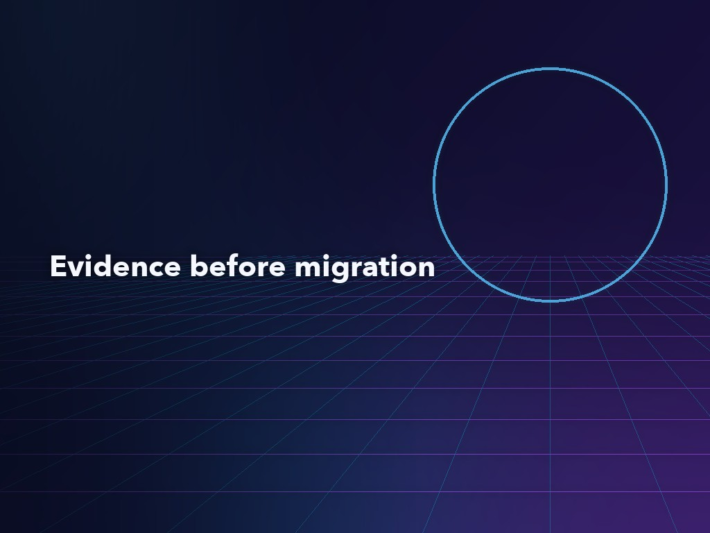
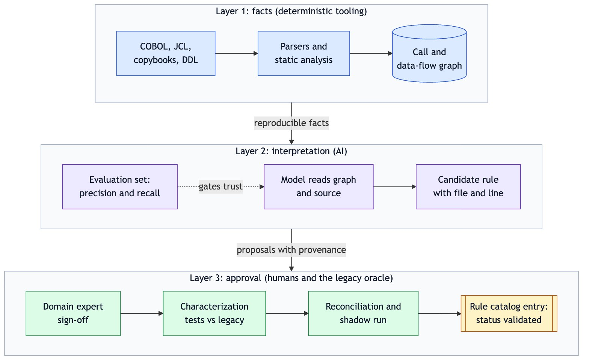
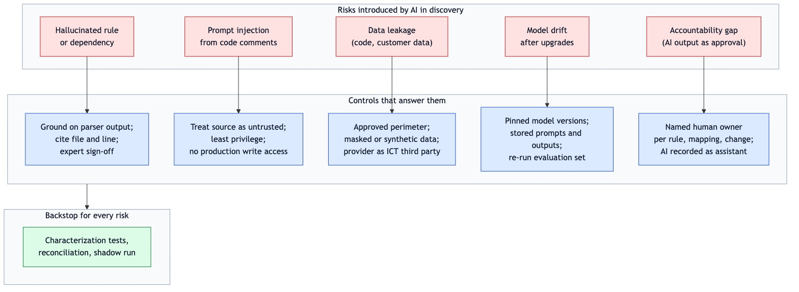

<!--
Meta description: A pattern for AI in core banking modernization: deterministic tools establish the facts, AI interprets them and experts plus the legacy system approve.
Tags: legacy modernization, core banking, COBOL, AI-assisted discovery, characterization testing, DORA, software architecture
-->



# Facts, Interpretation, Approval: A Pattern for AI in Core Banking Modernization

**Key Takeaways**

- AI is most useful in core banking modernization when it works on the slow part of the job, understanding what the legacy code does, and least useful when it is asked to translate COBOL into Java line by line.
- This article describes a pattern in which deterministic parsers and static analysis establish the facts, AI turns those facts into candidate business rules and approval comes from domain experts plus the legacy system as test oracle.
- Every AI-extracted rule needs provenance (source file and lines, model and prompt version) and an evaluation set of programs with known rules, so extraction precision and recall are measured before the pipeline is trusted on unknown code.
- Financial equivalence is shown with evidence: characterization tests against the legacy system, zero-tolerance reconciliation at record, account balance and general-ledger level, plus a parallel run that covers at least one full business cycle.
- Under DORA, the model provider is one more ICT third party, and prompt injection through code comments, leakage of source or customer data and model drift need explicit controls before AI touches a regulated estate.

---

*By Wallace Espindola, Solution Architect · [wallace.espindola@gmail.com](mailto:wallace.espindola@gmail.com) · [LinkedIn](https://www.linkedin.com/in/wallaceespindola/) · [GitHub](https://github.com/wallaceespindola/)*

*Companion repository with the modernization context, the rule catalog template, an illustrative COBOL program and the Java characterization tests discussed here: [github.com/wallaceespindola/banking-modernization-with-ai](https://github.com/wallaceespindola/banking-modernization-with-ai)*

---

## Where current practice stops

Banks keep mainframe workloads running for good reasons. They are fast, stable and audited. What erodes is the knowledge around them: the engineers who understand the interest, fee, rounding, eligibility and reconciliation rules retire, and the rules were rarely written down outside the code. Tests are thin, dependencies hide in shared copybooks, files and job schedules, and every change carries risk.

Two responses dominate the discussion. The first is the big-bang replacement, a new core system with a single cut-over weekend. The second is automated refactoring, where a tool converts COBOL into Java or C# at scale. The second option has a known failure mode, sometimes called "JOBOL": Java that keeps the COBOL structure, coupling and batch assumptions, with none of the benefits of the new platform. Large language models make that second option faster, and the speed is tempting. The slow part of these programs has always been understanding what the existing system does and proving that the new one does the same, and faster code generation doesn't shorten it.

This article describes a pattern that addresses that bottleneck. It separates three kinds of work: establishing facts about the legacy estate, interpreting those facts into business rules and approving those rules as the behavior the bank must keep. Each kind of work has a different owner and a different source of authority. The short form, used throughout the companion repository, is "AI proposes, deterministic tooling verifies, humans approve."

The analysis is grounded in an open repository: a modernization context document, a rule catalog template with one worked example (`BR-INT-001`, monthly interest accrual), an illustrative COBOL program and copybook plus a small Java 25 module with a packed-decimal decoder, the legacy-equivalent interest rule, golden-master tests and a reconciler. The repository is a reference implementation that does not come from a production program, so this article discusses design and trade-offs. It does not report adoption figures or outcomes.

## Two older ideas the pattern builds on

The pattern combines two ideas that predate generative AI by many years.

The first is incremental replacement. Martin Fowler's [Strangler Fig](https://martinfowler.com/bliki/StranglerFigApplication.html) article (current revision dated August 2024) argues for "a gradual process of modernization" in which new components take over functions of the old system one at a time until the old system can be switched off. In banking, the unit of change that works best is a business capability, such as fee calculation, statement generation or interest accrual, not a program or a language. Incremental replacement means coexistence, and coexistence brings its own requirements: a routing layer that can switch traffic per capability with instant fallback, an anti-corruption layer that keeps legacy data models out of the new domain, change data capture instead of dual writes and a single documented system of record per business date.

The second is the characterization test. Michael Feathers, in [Working Effectively with Legacy Code](https://www.informit.com/store/working-effectively-with-legacy-code-9780131177055) (2004), describes tests that record what the code actually does, rather than what a specification says it should do, so that a change can be checked against current behavior. For a bank, the existing system is the best available specification of its own financial behavior. Its outputs, including the quirks, are what the new implementation has to match until someone decides otherwise.

What is new is the middle step. Between "here is the code" and "here are the tests that pin its behavior" sits a large amount of reading, summarizing and rule extraction. That step used to be done entirely by scarce specialists, and it is where AI can shorten the work.

## The pattern: facts, interpretation, approval

The pattern assigns each layer of work to the kind of tooling or person that can be held to account for it.



*Figure 1: Facts, interpretation and approval as separate layers. Blue: deterministic tooling. Purple: AI. Green: humans and the legacy system as oracle. Amber: the artifact that records the approved rule.*

**Facts** come from deterministic tools. Parsers and static analysis read COBOL, JCL, copybooks, DDL and scheduler exports, and produce a dependency and data-lineage graph: which program calls which, which job writes which file, which field flows into which computation. These outputs are reproducible. Running the parser twice on the same source gives the same graph, which is the property an auditor will ask about.

**Interpretation** is where a model adds value. It summarizes programs, explains paragraphs, proposes candidate business rules and suggests where capability boundaries might fall. The model reasons over the graph and the source, and the graph stays the record of dependencies. That keeps dependency facts out of the model's hands and confines hallucination risk to the interpretation layer, where human review happens anyway.

**Approval** belongs to people and to the legacy system. A domain expert confirms that a candidate rule describes intended behavior. Characterization tests run against the legacy system confirm that the rule describes actual behavior. Reconciliation and shadow runs confirm that a modern implementation produces the same results on real (masked) volumes. Only then does the rule move to "validated" in the catalog.

When a regulator, an auditor or an incident review asks why a migrated capability behaves the way it does, the answer has to point to evidence that does not depend on a model's output. The pattern makes sure each approved rule can be traced back to a parser fact, a source location, a named approver and a passing test.

## The parts of the pattern

### A rule catalog with provenance

The rule catalog is the central artifact. Each entry describes one business rule found in the legacy code, and AI can draft it. A domain expert approves it, and it isn't complete until it links to the tests that prove the modern implementation matches the legacy one. Here are the main fields of the worked example, trimmed from the repository's template:

```markdown
## BR-INT-001: Monthly interest accrual

- Status: validated
- Source: `examples/cobol/INTCALC.cbl`, paragraph `2000-CALC-INTEREST`; copybook `examples/cobol/ACCTREC.cpy`
- Extracted by: AI-assisted discovery (model and prompt version recorded in the discovery log), reviewed against the parser's data-flow output
- Plain-language rule: for an active account, monthly interest is the balance times the annual rate in percent, divided by 1200. Closed accounts accrue nothing.
- Arithmetic: no `ROUNDED` phrase, so the result is truncated toward zero to two decimals. Intermediate precision depends on compiler options and is pinned by the characterization tests.
- Edge cases: negative balances (overdraft interest, truncated toward zero), zero balance, sub-cent results, maximum balance
- Approved by: domain expert sign-off recorded in the review (name kept out of the public example)
- Characterization tests: `examples/java/src/test/java/com/wtechitsolutions/bankingmodernization/InterestRuleGoldenMasterTest.java`, data in `examples/java/src/test/resources/golden/monthly-interest.csv`
```

Three fields carry the pattern. `Source` and `Extracted by` record provenance: which file and paragraph the rule came from, and which model and prompt version proposed it. `Status` (candidate, in review, validated or rejected) makes the approval state explicit, so a team can count how many extracted rules experts have actually confirmed. `Characterization tests` closes the loop from a sentence a domain expert can read to a test a build server can run.

### An evaluation set before unknown code

A model that extracts rules from COBOL needs to be measured like any other classifier. The context document recommends building an evaluation set early: programs whose rules are already known, against which extraction precision (how many proposed rules are real) and recall (how many real rules were found) can be measured before the pipeline is pointed at code nobody understands.

The evaluation set is also a regression suite for the AI pipeline itself. When the model version, the prompt or the retrieval setup changes, the evaluation runs again. Without it, a team has no way to tell whether a change made extraction better or worse, and no evidence to show a risk function that the pipeline is fit for use. In the 90-day plan in the repository, evaluation results for AI extraction are an exit criterion for the second month, next to the rule catalog and a characterization suite running against legacy.

### Characterization tests with the legacy system as oracle

Characterization tests are where the subtle differences between platforms show up. The worked example is a single COBOL statement:

```cobol
       2000-CALC-INTEREST.
           IF ACCT-ACTIVE
      *        No ROUNDED phrase: the result is truncated to two decimals.
               COMPUTE WS-MONTHLY-INT =
                   ACCT-BALANCE * ACCT-ANNUAL-RATE / 1200
           ELSE
               MOVE ZERO TO WS-MONTHLY-INT
           END-IF.
```

A `COMPUTE` without `ROUNDED` truncates the result to the decimals of the receiving field. The Java port in the repository uses `BigDecimal` with `RoundingMode.DOWN` (toward zero) to match. A port a reviewer might accept at first glance uses `RoundingMode.HALF_EVEN`, banker's rounding, which looks more correct. Run against the golden data, it disagrees with the legacy result on three of the eight accounts:

| Account | Balance | Annual rate | Legacy result | Naive port |
| --- | --- | --- | --- | --- |
| ACC-0001 | 1000.00 | 5.00 | 4.16 | 4.17 |
| ACC-0004 | 999999.99 | 4.10 | 3416.66 | 3416.67 |
| ACC-0007 | -100.00 | 19.99 | -1.66 | -1.67 |

The golden CSV in the repository is an illustrative fixture worked out by hand from the COBOL semantics, not output captured from a real bank. In a real program, the golden data comes from running the legacy system on representative and edge-case inputs before anything changes. Each difference is one cent, and each one would pass a code review that checks the formula rather than the rounding.

Rounding is one of several data-definition traps. Packed decimal (`COMP-3`) stores two digits per byte with the sign in the last nibble (C for positive, D for negative, F for unsigned), and the scale comes from the `PIC` clause rather than from the data. Signed zoned decimal, `REDEFINES`, `OCCURS DEPENDING ON`, EBCDIC collation that differs from ASCII sort order, Julian dates and century windowing from Y2K remediation all belong on the same list. A model can explain each of them. Only a test against the legacy output shows whether a given port got them right.

### Reconciliation at three levels

Characterization tests cover selected inputs. Reconciliation covers volume. The context document describes three levels, each per business date: individual records, account balances and general-ledger totals. The tolerance policy for amounts is normally zero, and someone has to sign that policy off explicitly.

The repository's `Reconciler` covers the account level plus an aggregate total. It compares legacy and modern results per account and reports a break for any difference, including an account that appears on only one side. It also checks that the legacy and modern totals agree. Missing accounts matter as much as wrong amounts, because a record dropped during migration doesn't show up in a field-by-field comparison of the records that did arrive. The general-ledger level isn't in the repository. It adds the check finance teams care about most, that the totals posted per business date agree, and a real program has to build it against its own ledger.

### Shadow runs and parallel runs

The last part is running both systems side by side. In shadow mode, the new service computes results without committing them, and the reconciliation engine compares them with the legacy results. The context document recommends a parallel run for at least one full business cycle that includes month-end and, when relevant, year-end processing, because those are the runs where accruals, fee caps and statement cycles concentrate. Operational tests belong in the same phase: failover, restart in the middle of a batch, duplicate message handling and replay.

Go and no-go criteria for production traffic are agreed before the slice is built, not after the first reconciliation report arrives. That ordering prevents a familiar drift, where the acceptance threshold moves to fit the results.

## What the architect owns

The pattern shifts a solution architect's time away from drawing the target state and toward defining the evidence that proves each transition step is safe and making sure that evidence is produced as part of delivery rather than reconstructed afterwards.

In practice, that means the architect chooses the first capability (valuable enough to matter, bounded enough to finish, with low write coupling to the core ledger) and sets the consistency model per capability. The architect also defines non-functional targets (end-of-day throughput, RPO and RTO, the batch window) and governs the quality gates: equivalence, reconciliation, observability, rollout and rollback. Decisions are recorded as architecture decision records from the first day. AI changes the inputs to these decisions, such as faster inventories, candidate boundaries and draft rule entries, but the context document is explicit that prioritization scores stay transparent and the architect decides.

## Governance under DORA and the EU AI Act

Regulation shapes this pattern more than it shapes most AI adoption in software teams. The EU's [Digital Operational Resilience Act](https://eur-lex.europa.eu/eli/reg/2022/2554/oj) (Regulation (EU) 2022/2554) has applied since 17 January 2025. It covers ICT risk management, incident reporting, resilience testing and ICT third-party risk, including cloud concentration risk and exit strategies. For an AI-assisted modernization program, the direct consequence is that the model provider is an ICT third party like any other. The companion context recommends registering it as one, running models inside the bank's approved perimeter (private endpoints or on-premises) and securing contractual guarantees on data retention and training use.

The EU AI Act is on the list of frameworks to check where AI touches regulated decisions. In the pattern described here, AI doesn't make the regulated decision. It drafts rules and tests that people approve. That's a deliberate design choice, and it holds only if the experts actually review what they sign. Other frameworks to check per institution include the EBA guidelines on outsourcing and ICT risk, BCBS 239 for risk data aggregation, GDPR for personal data in test and training sets and PSD2 for payment services. This article does not interpret any of them. Each institution's compliance function has to map them to its own program.

The useful habit is to treat regulatory evidence as a delivery output. ADRs, the rule catalog with its approval states, characterization test results, reconciliation reports and change records are produced by the pipeline as the work happens. A team that has to assemble them afterwards usually finds gaps.

## Risks and the controls that answer them

Introducing AI into discovery adds risks that a purely manual or purely tool-driven program does not have. The context document pairs each one with a control.



*Figure 2: Each AI-specific risk has a direct control, and the verification layer acts as a backstop for all of them. Red: risks. Blue: controls. Green: the backstop.*

### Hallucination

A model can describe a rule that the code does not implement, or miss a dependency that only shows up in a JCL step. The controls are structural: ground every summary on parser output, cite file and line ranges and require expert sign-off before a rule leaves "candidate" status. Dependency facts come from the graph, not from the model, so a hallucinated call does not become an architectural assumption.

### Prompt injection from code comments

Comments and string literals in legacy code are input to the model, and nobody reviewed them with that use in mind. A comment that reads like an instruction can steer a model that has been given tools. The context treats all source as untrusted input, gives agents least privilege and no write access to production systems and limits AI in operations to read-only explanation of abends, job failures and reconciliation breaks.

### Data leakage

Source code is intellectual property and may contain hard-coded data. Test data and production samples may contain customer data. The controls are deployment inside the approved perimeter, contractual terms on retention and training and masking or synthetic data before anything reaches a model. Access to a knowledge assistant built over the code mirrors the permissions on the source.

### Model drift

A model upgrade can change extraction behavior without any change to the code under analysis. The controls are pinned model versions, stored prompts and outputs and re-running the evaluation set on every upgrade. This is the same discipline teams already apply to compilers and build tools, extended to a less predictable component.

### Accountability

The last risk is organizational. If AI output is recorded as approval, nobody owns the result. The pattern requires a named human owner for each approved rule, mapping and code change, with AI recorded as an assistant. The characterization tests, reconciliation and shadow runs sit underneath all five risks as a backstop: whatever went wrong upstream, a financial difference still has to get past a zero-tolerance comparison with the legacy system.

## Where the pattern does not pay off

The pattern has fixed costs. Building parsers or adopting static analysis for an estate, curating an evaluation set, writing catalog entries and running reconciliation all take time before the first slice moves. For a small estate with a few well-understood programs, a careful manual reading by the remaining specialists may be cheaper than setting up an AI pipeline and measuring it.

It also depends on having an oracle. Characterization tests need a legacy system that can still run representative inputs, and reconciliation needs comparable outputs per business date. Where the legacy environment cannot be exercised in a controlled way, the approval layer weakens, and the pattern loses most of its value.

Some strategies make it less relevant. A capability that will be retained and encapsulated behind an API needs understanding but not equivalence proofs. A commodity capability replaced by a package needs data migration and reconciliation, but the rule extraction effort may be better spent on configuring the package. Dead and duplicated code, which can make up a significant share of an inventory, should be identified and retired, not catalogued.

Finally, the pattern doesn't remove the need for scarce people. It changes their work from writing everything down to reviewing and approving drafts. If the domain experts are not available for that review, candidate rules accumulate and nothing reaches "validated," however fast the extraction runs.

## Conclusion

AI changes the economics of understanding a legacy banking estate. It does not change who answers for its financial behavior. The pattern described here keeps those two things apart: deterministic tooling for facts, AI for interpretation and domain experts and the legacy system for approval, with every rule carrying its provenance and every slice carrying its evidence. Characterization tests, three-level reconciliation and parallel runs over a full business cycle are established practices. In this pattern they are the acceptance criteria that make AI-assisted discovery safe to use in a regulated estate.

A team can try the pattern on one bounded capability with a handful of catalog entries, an evaluation set built from rules it already knows and a characterization suite against the legacy output. How does your organization decide when an AI-extracted business rule is trustworthy enough to build on?

## References

- Martin Fowler, [Strangler Fig](https://martinfowler.com/bliki/StranglerFigApplication.html), martinfowler.com, August 2024
- Michael Feathers, [Working Effectively with Legacy Code](https://www.informit.com/store/working-effectively-with-legacy-code-9780131177055), Prentice Hall, 2004
- European Union, [Regulation (EU) 2022/2554 on digital operational resilience for the financial sector (DORA)](https://eur-lex.europa.eu/eli/reg/2022/2554/oj), EUR-Lex
- Companion repository with the modernization context, rule catalog template, illustrative COBOL and Java characterization tests: [github.com/wallaceespindola/banking-modernization-with-ai](https://github.com/wallaceespindola/banking-modernization-with-ai)

## About the author

**Wallace Espindola, Solution Architect**

Wallace Espindola is a senior software engineer and solution architect working across Java/Spring Boot and Python/FastAPI backends, cloud-native microservices on Kubernetes and OpenShift, and system architecture design. He maintains the open-source repository behind this article, which describes how a solution architect can run a legacy banking modernization with AI as an assistant and deterministic verification as the authority.

Contact: [wallace.espindola@gmail.com](mailto:wallace.espindola@gmail.com) · [LinkedIn](https://www.linkedin.com/in/wallaceespindola/) · [GitHub](https://github.com/wallaceespindola/)

---

**AI disclosure**: This article was drafted with AI assistance (Claude) for research support, outlining, drafting and editing, based on the author's own modernization context document and repository. Code, figures and regulatory references were checked against the repository and the cited sources.

**Publishing note**: This article is submitted for InfoQ's 4-week exclusive publishing window. It will not be cross-posted to other platforms until that window closes.

**Examples repository:** this article uses the rule catalog template with the BR-INT-001 entry, the illustrative `INTCALC.cbl` program, the golden-master interest tests and the reconciler from <https://github.com/wallaceespindola/banking-modernization-with-ai>.

Need more tech insights?\
Check out my GitHub, LinkedIn, and Speaker Deck.\
Happy coding!

Wallace Espindola, Solution Architect\
GitHub: <https://github.com/wallaceespindola/>\
LinkedIn: <https://www.linkedin.com/in/wallaceespindola/>\
Speaker Deck: <https://speakerdeck.com/wallacese>
