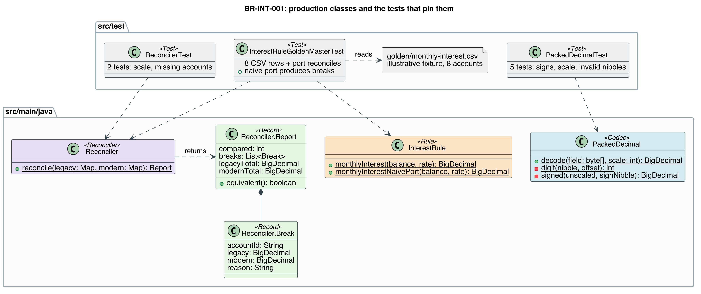
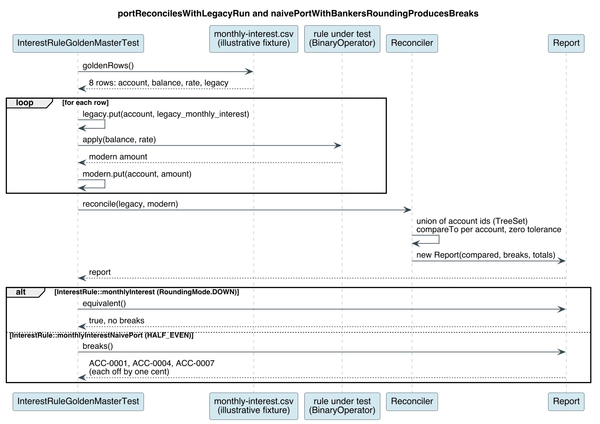

<!--
Submission metadata
Keywords: COBOL, COMP-3, BigDecimal, RoundingMode, golden master, characterization tests, reconciliation
Summary: Port one COBOL interest rule to Java 21 and prove it matches the legacy output to the cent with COMP-3 decoding, BigDecimal and JUnit golden-master tests.
-->


# From a banking COBOL COMPUTE to tested Java 21: proving equivalence to the cent

**By Wallace Espindola, Solution Architect**
<wallace.espindola@gmail.com> | [LinkedIn](https://www.linkedin.com/in/wallaceespindola/) | [GitHub](https://github.com/wallaceespindola/)

---

## Abstract

A COBOL interest calculation can be one `COMPUTE` statement, and its Java port can still be wrong in ways a code review won't catch: the picture clause sets the scale, a missing `ROUNDED` means truncation, and the inputs arrive as packed decimal bytes. This article walks through a small Java 21 module that ports one rule, BR-INT-001 (monthly interest accrual), and proves it matches the legacy output to the cent. It covers `COMP-3` decoding with sign-nibble validation, `BigDecimal` with explicit scale and `RoundingMode.DOWN`, a golden-master test with `@CsvFileSource`, zero-tolerance reconciliation with `compareTo`, and a naive port kept as a negative test. It is written for Java developers and reviewers who own a port like this one, and for the architects who have to sign off that it is equivalent. Two limits stay open on purpose. The closed-account branch (`ACCT-ACTIVE`) is not ported in the example, and intermediate precision, which depends on COBOL compiler options, is pinned by the characterization tests rather than derived. The article shows how both gaps stay visible next to a green build.

---

## Introduction

When a bank moves a capability off the mainframe, the pull request that ports a business rule usually looks harmless: a few lines of arithmetic, a unit test, green CI. What the reviewer can't check from the diff alone is whether the new code computes exactly what the old code computed, for every account, including negative balances and amounts below a cent.

That question is the acceptance criterion. The series repository states the principle as "correctness is proven, not assumed": AI can draft the rule catalog entry and propose the port, but the legacy system is the oracle and deterministic tests decide.

This article is the code-level version of that principle: one rule from an illustrative COBOL program, its copybook, and the four Java classes that make the port reviewable. All of it is in the companion repository, [banking-modernization-with-ai](https://github.com/wallaceespindola/banking-modernization-with-ai), under `examples/`. The COBOL is illustrative and isn't compiled. The Java module is real: Java 21, JUnit 5, 17 tests, all green.

## The legacy side: one COMPUTE and a copybook

The rule lives in paragraph `2000-CALC-INTEREST` of `INTCALC.cbl`. Here is the procedure part, trimmed from the repo:

```cobol
       WORKING-STORAGE SECTION.
       COPY ACCTREC.
       01  WS-MONTHLY-INT              PIC S9(11)V99 COMP-3.

       PROCEDURE DIVISION.
       2000-CALC-INTEREST.
           IF ACCT-ACTIVE
      *        No ROUNDED phrase: the result is truncated to two decimals.
               COMPUTE WS-MONTHLY-INT =
                   ACCT-BALANCE * ACCT-ANNUAL-RATE / 1200
           ELSE
               MOVE ZERO TO WS-MONTHLY-INT
           END-IF.
```

Three things matter for the port. The receiving field is `PIC S9(11)V99`, so the result has two decimals, with an implied decimal point (the `V`) that isn't stored in the data. The `COMPUTE` has no `ROUNDED` phrase, so COBOL truncates instead of rounding. And the inputs come from a copybook, trimmed here to the fields the rule uses:

```cobol
       01  ACCT-REC.
           05  ACCT-ID                 PIC X(8).
           05  ACCT-STATUS             PIC X(1).
               88  ACCT-ACTIVE                   VALUE 'A'.
               88  ACCT-CLOSED                   VALUE 'C'.
           05  ACCT-BALANCE            PIC S9(11)V99 COMP-3.
           05  ACCT-ANNUAL-RATE        PIC S9(3)V99  COMP-3.
```

The copybook is shared with other batch programs, so it is an implicit contract. It tells you what the program doesn't: balance and rate are `COMP-3` (packed decimal), with two implied decimals each. The rule catalog entry for BR-INT-001 (`docs/templates/rule-catalog-entry.md`) supplies the meaning: the rate is an annual percentage, so the divisor 1200 is twelve months times one hundred percent. The entry also records that closed accounts accrue nothing, that the result is truncated toward zero, and that intermediate precision depends on compiler options and is pinned by the characterization tests.



The module has three final classes with static methods, two records and three test classes. Nothing needs a framework, so the review is about arithmetic.

## Reading the bytes: COMP-3 into BigDecimal

In `COMP-3` each byte holds two digits, one per nibble, and the last nibble is the sign: `C` positive, `D` negative, `F` unsigned. The scale isn't in the bytes. It comes from the picture clause. Here is the full decoder:

```java
package com.wtechitsolutions.bankingmodernization;

import java.math.BigDecimal;
import java.math.BigInteger;

/**
 * Decodes COBOL {@code COMP-3} (packed decimal) fields into {@link BigDecimal}.
 *
 * <p>Each byte holds two decimal digits, one per nibble. The last nibble is the sign:
 * {@code C} (positive), {@code D} (negative) or {@code F} (unsigned). The scale comes from the
 * copybook picture clause, not from the bytes: {@code PIC S9(3)V99 COMP-3} has scale 2.
 */
public final class PackedDecimal {

    private static final int SIGN_POSITIVE = 0xC;
    private static final int SIGN_NEGATIVE = 0xD;
    private static final int SIGN_UNSIGNED = 0xF;

    private PackedDecimal() {
    }

    public static BigDecimal decode(byte[] field, int scale) {
        if (field == null || field.length == 0) {
            throw new IllegalArgumentException("Packed decimal field is empty");
        }
        StringBuilder digits = new StringBuilder(field.length * 2);
        for (int i = 0; i < field.length; i++) {
            int high = (field[i] >> 4) & 0x0F;
            int low = field[i] & 0x0F;
            digits.append(digit(high, i));
            if (i < field.length - 1) {
                digits.append(digit(low, i));
            } else {
                return signed(new BigInteger(digits.toString()), low).movePointLeft(scale).setScale(scale);
            }
        }
        throw new IllegalStateException("unreachable");
    }

    private static int digit(int nibble, int offset) {
        if (nibble > 9) {
            throw new IllegalArgumentException("Invalid digit nibble 0x%X at byte %d".formatted(nibble, offset));
        }
        return nibble;
    }

    private static BigDecimal signed(BigInteger unscaled, int signNibble) {
        return switch (signNibble) {
            case SIGN_POSITIVE, SIGN_UNSIGNED -> new BigDecimal(unscaled);
            case SIGN_NEGATIVE -> new BigDecimal(unscaled.negate());
            default -> throw new IllegalArgumentException("Invalid sign nibble 0x%X".formatted(signNibble));
        };
    }
}
```

The `& 0x0F` after the shift matters because Java bytes are signed: without it, `0x9D` would shift into a negative int. Digits go into a `BigInteger` before they become a `BigDecimal`, so there is no floating-point step. The caller passes the scale, and `setScale(scale)` keeps it, so `05 0F` with scale 2 decodes to `0.50`, not `0.5`.

The part I'd want a reviewer to check is the validation. A digit nibble above 9 throws, and so does any sign other than `C`, `D` or `F`. A decoder that treated an unknown sign as positive would turn a corrupted record into a plausible amount. (If your data uses other sign conventions, agree that with the data owners and add a test instead of guessing a default.) `PackedDecimalTest` pins five cases: `12 34 5C` gives `123.45`, `12 34 5D` gives `-123.45`, `05 0F` gives `0.50`, and invalid sign (`5A`) and digit (`1B`) nibbles throw.

## The rule: explicit scale, explicit rounding

The rule itself is one line. Here is the full class:

```java
package com.wtechitsolutions.bankingmodernization;

import java.math.BigDecimal;
import java.math.RoundingMode;

/**
 * Business rule BR-INT-001: monthly interest on a balance, equivalent to the legacy COBOL statement
 * {@code COMPUTE WS-MONTHLY-INT = ACCT-BALANCE * ACCT-ANNUAL-RATE / 1200} in {@code examples/cobol/INTCALC.cbl}.
 *
 * <p>The COBOL statement has no {@code ROUNDED} phrase, so the result is truncated toward zero to the
 * two decimals of the receiving field. The Java port must do the same, or it is off by a cent wherever
 * rounding and truncation disagree. See {@code docs/templates/rule-catalog-entry.md} for the catalog entry.
 */
public final class InterestRule {

    private static final BigDecimal MONTHS_TIMES_PERCENT = new BigDecimal("1200");
    private static final int MONEY_SCALE = 2;

    private InterestRule() {
    }

    /** Legacy-equivalent result: truncation toward zero, like COBOL without {@code ROUNDED}. */
    public static BigDecimal monthlyInterest(BigDecimal balance, BigDecimal annualRatePercent) {
        // One division on an exact product. If the compiler used a smaller intermediate precision
        // (ARITH option), pin that from the characterization tests before changing this line.
        return balance.multiply(annualRatePercent).divide(MONTHS_TIMES_PERCENT, MONEY_SCALE, RoundingMode.DOWN);
    }

    /** The port a reviewer would accept at first glance: banker's rounding. Kept to show the break. */
    public static BigDecimal monthlyInterestNaivePort(BigDecimal balance, BigDecimal annualRatePercent) {
        return balance.multiply(annualRatePercent).divide(MONTHS_TIMES_PERCENT, MONEY_SCALE, RoundingMode.HALF_EVEN);
    }
}
```

Scale 2 comes from `V99`. `RoundingMode.DOWN` means toward zero, which matters for overdrafts: `-1.6658...` must become `-1.66`, while `FLOOR` would give `-1.67`. No `double` appears anywhere, which is the rule the repository applies to all money.

`multiply` without a `MathContext` is exact, so precision is lost only in the single `divide`, where scale and rounding are stated. COBOL intermediate precision depends on compiler options, as the comment says, and the Java code doesn't guess it: the characterization tests pin the legacy output, and if they disagree with this line, the line changes. The second method, `monthlyInterestNaivePort`, uses `HALF_EVEN`, the mode a reviewer is most likely to accept as correct for money. It stays in the class so the suite can prove it wrong.

## The golden master: legacy output as the oracle

A characterization test, in Michael Feathers' sense, records what the system does today. In a real migration you capture it from a legacy batch run on masked data. In this repository the CSV is an illustrative fixture, worked out by hand from the COBOL semantics, not captured from a real bank:

```csv
account,balance,annual_rate_percent,legacy_monthly_interest
ACC-0001,1000.00,5.00,4.16
ACC-0002,2500.00,3.75,7.81
ACC-0003,1234.56,2.50,2.57
ACC-0004,999999.99,4.10,3416.66
ACC-0005,0.01,5.00,0.00
ACC-0006,-150.00,18.00,-2.25
ACC-0007,-100.00,19.99,-1.66
ACC-0008,0.00,7.25,0.00
```

The rows cover the catalog's edge cases: ordinary truncation, a large balance, a sub-cent result, exact and truncated overdrafts, and zero. Here is the full test class:

```java
package com.wtechitsolutions.bankingmodernization;

import static org.junit.jupiter.api.Assertions.assertEquals;
import static org.junit.jupiter.api.Assertions.assertFalse;
import static org.junit.jupiter.api.Assertions.assertTrue;

import java.io.IOException;
import java.io.InputStream;
import java.io.UncheckedIOException;
import java.math.BigDecimal;
import java.nio.charset.StandardCharsets;
import java.util.LinkedHashMap;
import java.util.List;
import java.util.Map;
import java.util.function.BinaryOperator;
import org.junit.jupiter.api.Test;
import org.junit.jupiter.params.ParameterizedTest;
import org.junit.jupiter.params.provider.CsvFileSource;

/**
 * Characterization (golden master) tests for BR-INT-001. The CSV holds outputs captured from the legacy
 * batch run; the legacy system is the oracle. In this repository the values are an illustrative fixture,
 * worked out by hand from the COBOL semantics.
 */
class InterestRuleGoldenMasterTest {

    private static final String GOLDEN = "/golden/monthly-interest.csv";

    @ParameterizedTest(name = "{0}: {1} at {2}% -> {3}")
    @CsvFileSource(resources = GOLDEN, numLinesToSkip = 1)
    void matchesLegacyOutputToTheCent(String account, BigDecimal balance, BigDecimal rate, BigDecimal expected) {
        assertEquals(expected, InterestRule.monthlyInterest(balance, rate), account);
    }

    @Test
    void portReconcilesWithLegacyRun() {
        Reconciler.Report report = reconcileAgainstGolden(InterestRule::monthlyInterest);

        assertTrue(report.equivalent(), () -> "Breaks: " + report.breaks());
    }

    @Test
    void naivePortWithBankersRoundingProducesBreaks() {
        Reconciler.Report report = reconcileAgainstGolden(InterestRule::monthlyInterestNaivePort);

        assertFalse(report.equivalent());
        assertEquals(List.of("ACC-0001", "ACC-0004", "ACC-0007"), report.breaks().stream().map(Reconciler.Break::accountId).toList());
    }

    private static Reconciler.Report reconcileAgainstGolden(BinaryOperator<BigDecimal> rule) {
        Map<String, BigDecimal> legacy = new LinkedHashMap<>();
        Map<String, BigDecimal> modern = new LinkedHashMap<>();
        for (String[] row : goldenRows()) {
            legacy.put(row[0], new BigDecimal(row[3]));
            modern.put(row[0], rule.apply(new BigDecimal(row[1]), new BigDecimal(row[2])));
        }
        return Reconciler.reconcile(legacy, modern);
    }

    private static List<String[]> goldenRows() {
        try (InputStream in = InterestRuleGoldenMasterTest.class.getResourceAsStream(GOLDEN)) {
            String csv = new String(in.readAllBytes(), StandardCharsets.UTF_8);
            return csv.lines().skip(1).filter(line -> !line.isBlank()).map(line -> line.split(",")).toList();
        } catch (IOException e) {
            throw new UncheckedIOException(e);
        }
    }
}
```

`@CsvFileSource` reads the file from the test classpath, skips the header and converts each column to `BigDecimal` from its string. The display name puts account and numbers in the report, so a failure reads as a business statement. `assertEquals` calls `BigDecimal.equals`, which compares scale too. That is intended here: the test also pins scale 2. The other two tests pass the rule as a `BinaryOperator<BigDecimal>`, so one harness runs both ports. The harness splits lines with plain `String.split`, which is fine for this fixture and wouldn't be for a real legacy extract.



## Reconciliation with zero tolerance

The reconciler outlives the unit tests: the same comparison runs in a shadow or parallel run over a business date's accounts. Here is the full class:

```java
package com.wtechitsolutions.bankingmodernization;

import java.math.BigDecimal;
import java.util.ArrayList;
import java.util.List;
import java.util.Map;
import java.util.TreeSet;

/**
 * Compares legacy and modernized results per account for one business date. Tolerance is zero:
 * any difference, including an account present on one side only, is a break.
 */
public final class Reconciler {

    public record Break(String accountId, BigDecimal legacy, BigDecimal modern, String reason) {
    }

    public record Report(int compared, List<Break> breaks, BigDecimal legacyTotal, BigDecimal modernTotal) {

        public boolean equivalent() {
            return breaks.isEmpty() && legacyTotal.compareTo(modernTotal) == 0;
        }
    }

    private Reconciler() {
    }

    public static Report reconcile(Map<String, BigDecimal> legacy, Map<String, BigDecimal> modern) {
        TreeSet<String> accounts = new TreeSet<>(legacy.keySet());
        accounts.addAll(modern.keySet());

        List<Break> breaks = new ArrayList<>();
        for (String account : accounts) {
            BigDecimal l = legacy.get(account);
            BigDecimal m = modern.get(account);
            if (l == null) {
                breaks.add(new Break(account, null, m, "missing in legacy"));
            } else if (m == null) {
                breaks.add(new Break(account, l, null, "missing in modern"));
            } else if (l.compareTo(m) != 0) {
                breaks.add(new Break(account, l, m, "amount differs by " + m.subtract(l).toPlainString()));
            }
        }
        return new Report(accounts.size(), List.copyOf(breaks), sum(legacy), sum(modern));
    }

    private static BigDecimal sum(Map<String, BigDecimal> amounts) {
        return amounts.values().stream().reduce(BigDecimal.ZERO, BigDecimal::add);
    }
}
```

Four decisions in this class are the ones to check in review:

- **Zero tolerance:** no epsilon. A non-zero tolerance is a business decision with a named owner, not a constant in code.
- **`compareTo`, not `equals`:** a legacy extract may deliver `10.0` where the port gives `10.00`, and `equals` would report a false break. `ReconcilerTest.equalAmountsWithDifferentScaleAreNotABreak` pins that.
- **Missing accounts are breaks:** the account set is the union of both sides, so a record only one system processed shows up as `missing in legacy` or `missing in modern`.
- **Deterministic output:** records, `List.copyOf` and a `TreeSet` give the same report for the same data, and `equivalent()` checks the totals as well.

## The naive port as a deliberate negative test

`naivePortWithBankersRoundingProducesBreaks` is the test I'd point to first in a review. It asserts that the `HALF_EVEN` port fails, and on which accounts:

| Account | Exact result | Legacy (`DOWN`) | Naive (`HALF_EVEN`) |
| --- | --- | --- | --- |
| ACC-0001 | 4.1666... | 4.16 | 4.17 |
| ACC-0004 | 3416.6666... | 3416.66 | 3416.67 |
| ACC-0007 | -1.6658... | -1.66 | -1.67 |

The other five rows agree, which is why a unit test with friendly inputs misses the bug: `2500.00` at `3.75` gives `7.81` either way. If someone adds a tolerance to the reconciler or edits the golden file into something both ports satisfy, this test fails. A suite that can't fail on a known-wrong port isn't evidence of much.

## Mapping rule edge cases to tests

Each edge case of BR-INT-001, and where it is pinned:

| Rule edge case | Test |
| --- | --- |
| Ordinary result truncated to two decimals | `matchesLegacyOutputToTheCent` (ACC-0001, ACC-0002, ACC-0003) |
| Large balance | `matchesLegacyOutputToTheCent` (ACC-0004, 999,999.99) |
| Result below one cent | `matchesLegacyOutputToTheCent` (ACC-0005 gives 0.00) |
| Negative balance, exact result | `matchesLegacyOutputToTheCent` (ACC-0006) |
| Negative balance, truncated toward zero | `matchesLegacyOutputToTheCent` (ACC-0007) |
| Zero balance | `matchesLegacyOutputToTheCent` (ACC-0008) |
| Truncation, not rounding | `naivePortWithBankersRoundingProducesBreaks` |
| Whole run reconciles | `portReconcilesWithLegacyRun` |
| `COMP-3` sign and scale | `PackedDecimalTest` (positive, negative, unsigned with scale kept) |
| Corrupt packed data | `PackedDecimalTest` (invalid sign nibble, invalid digit nibble) |
| Same value, different scale | `ReconcilerTest.equalAmountsWithDifferentScaleAreNotABreak` |
| Missing or extra accounts | `ReconcilerTest.reportsAmountDifferencesAndMissingAccounts` |
| Closed account accrues nothing | Not ported: the `ACCT-ACTIVE` branch has no Java equivalent in the example |
| Maximum balance for `S9(11)V99` | Not covered: the largest fixture balance is 999,999.99 |

Green tests don't show that the closed-account branch was never ported, or that no fixture row gets near the field's maximum. The last two rows of the table do.

## Running it

The module targets Java 21 (`maven.compiler.release` is 21) and was tested on Java 21. It needs Maven. From the repository root, or directly in the module:

```bash
make test
cd examples/java && mvn -q test
```

That runs 17 tests: 10 golden-master (8 rows plus 2 reconciliation), 5 `PackedDecimalTest`, 2 `ReconcilerTest`. Switch `monthlyInterest` to `HALF_EVEN` and three rows plus `portReconcilesWithLegacyRun` go red.

## Where it doesn't pay off

- **The fixture is only as good as its source:** hand-worked values are fine for teaching, not as evidence. Real golden data comes from the legacy system on masked or synthetic data, and capturing it takes time and access.
- **Intermediate precision isn't modelled:** only captured legacy output reveals where compiler options change a last digit.
- **Eight rows prove eight rows:** property-based tests and a parallel run over a full business cycle, month-end included, widen the coverage.
- **One rule is the easy part:** no batch restart, business-day calendar, Julian dates or `REDEFINES` here, and that's often where the effort goes.
- **The negative test is a teaching device:** in a larger code base I'd move the naive variant into the test sources.

## Conclusion

Proving a port equivalent to the cent comes down to decisions a reviewer can check in the diff: reject malformed packed decimal at the boundary, state scale and rounding on every money operation, make legacy output the oracle, reconcile by value with zero tolerance, and keep one wrong port the suite must catch. Read the receiving field's picture clause before the arithmetic, treat a missing `ROUNDED` as a requirement, and write down the edge cases you haven't covered yet.

## References

- banking-modernization-with-ai (context document, rule catalog template, COBOL and Java examples), [GitHub](https://github.com/wallaceespindola/banking-modernization-with-ai)
- Java SE 21 API: `java.math.BigDecimal`, [docs.oracle.com](https://docs.oracle.com/en/java/javase/21/docs/api/java.base/java/math/BigDecimal.html)
- Java SE 21 API: `java.math.RoundingMode`, [docs.oracle.com](https://docs.oracle.com/en/java/javase/21/docs/api/java.base/java/math/RoundingMode.html)
- JUnit 5 User Guide: parameterized tests and `@CsvFileSource`, [junit.org](https://junit.org/junit5/docs/5.11.4/user-guide/#writing-tests-parameterized-tests)
- Michael Feathers, Working Effectively with Legacy Code (characterization tests), [O'Reilly](https://www.oreilly.com/library/view/working-effectively-with/0131177052/)

---

## Author bio

Wallace Espindola is a senior software engineer and solution architect working with Java/Spring Boot, Python/FastAPI and cloud-native microservices on Kubernetes and OpenShift. Lately he has been looking at how banks can modernize legacy cores one capability at a time, with AI as an assistant and deterministic tests as the authority on financial correctness.

Reach him on [LinkedIn](https://www.linkedin.com/in/wallaceespindola/) or check out his projects on [GitHub](https://github.com/wallaceespindola/).

---

When you review a port of financial logic, what evidence do you ask for before you approve it?

*I wrote this article with AI assistance, then reviewed, fact-checked and edited it myself.*

**Examples repository:** every example in this article (the `INTCALC` program and `ACCTREC` copybook, the BR-INT-001 rule catalog entry, `PackedDecimal`, `InterestRule`, `Reconciler`, the three test classes and the illustrative golden CSV) is in <https://github.com/wallaceespindola/banking-modernization-with-ai>.

Need more tech insights?\
Check out my GitHub, LinkedIn, and Speaker Deck.\
Happy coding!

Wallace Espindola, Solution Architect\
GitHub: <https://github.com/wallaceespindola/>\
LinkedIn: <https://www.linkedin.com/in/wallaceespindola/>\
Speaker Deck: <https://speakerdeck.com/wallacese>
