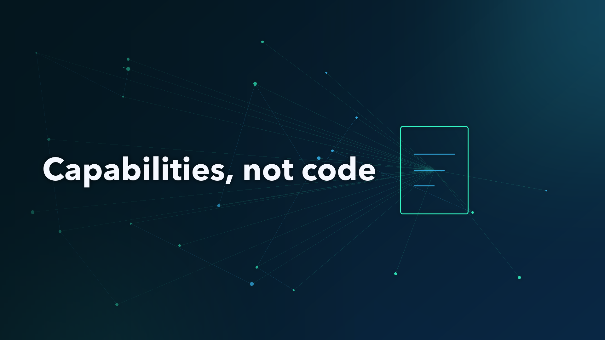

# Don't modernize the bank's mainframe. Modernize one capability

Most banks that start a core modernization program start from the same place. The mainframe still runs the ledger, the overnight batch and the interest and fee calculations, and it runs them reliably. The people who understand that code are fewer every year, the business rules live in COBOL and in a few specialists' heads, and the change backlog keeps growing. Then someone asks for a plan to "get off the mainframe".

That request is where the first leadership mistake usually happens. A plan to replace the whole core is a plan for a big-bang cut-over weekend, a long parallel run and a budget nobody can defend. This article is about the smaller set of decisions a CIO, head of engineering or architecture lead makes in the first 90 days instead: which capability goes first, how AI is allowed in, what counts as done, and who pays for switching the old thing off. The context document, a rule catalog template and a worked interest example live here: [banking-modernization-with-ai on GitHub](https://github.com/wallaceespindola/banking-modernization-with-ai).

## The problem leaders see

The difficulties are rarely just technical. Business rules for interest, fees, rounding and eligibility are embedded in code and poorly documented. Shared copybooks and files act as implicit contracts between programs that don't talk to each other. The org chart often mirrors the monolith, so new service boundaries fail unless team ownership changes with them. And run teams are rewarded for stability while change teams are rewarded for delivery, when modernization needs both.

The obvious workaround is to translate the COBOL line by line into Java. That tends to produce what people call "JOBOL": Java that keeps the COBOL structure, coupling and batch assumptions, with none of the benefits. So the unit of change has to be something else.

## The principle: capabilities, not code

I'd frame the whole program around three rules, taken from the [context document in the repo](https://github.com/wallaceespindola/banking-modernization-with-ai/blob/main/docs/banking-modernization-with-ai-context.md):

- **Modernize capabilities, not code:** the unit of change is a business capability (fees, statements, payments initiation), not a program or a language.
- **Correctness is proven, not assumed:** every slice demonstrates equivalence against the legacy system through characterization tests, parallel runs and ledger-level reconciliation.
- **AI proposes, deterministic tooling verifies, humans approve:** AI shortens discovery and implementation, and it never becomes the authority on financial behavior.

## Decision one: pick one bounded capability

The first capability should be valuable enough to matter and bounded enough to finish. That's harder than it sounds, because the most painful capability is often the one most tightly coupled to the core ledger. Four criteria help:

- **A clear business owner:** with domain experts who have time to review rules.
- **Low write coupling to the ledger:** read-heavy or calculation-heavy work such as fee calculation, statement generation or customer inquiry.
- **Measurable outputs:** results that can be compared with the legacy system, field by field.
- **Visible pain today:** a change backlog, a skills risk or a cost that the business already feels.

Everything else waits. The other capabilities stay where they are, behind a routing layer and an anti-corruption layer, until the first slice has proven the approach.

## Decision two: make AI use an approved decision

AI is useful in this work. It can summarize programs and copybooks, propose candidate business rules with source links, help map dependencies and generate characterization test cases. It can also invent a rule that isn't there. So treat AI use as a decision you take with security, risk and procurement in the first 30 days, before anyone starts using it informally.

The controls I'd want in writing before any code reaches a model:

- **Deployment:** models run inside the bank's approved perimeter, with contractual terms on data retention and training use. Under [DORA](https://eur-lex.europa.eu/eli/reg/2022/2554/oj), which has applied since 17 January 2025, the model provider is an ICT third party and gets registered as one.
- **Data:** source code is intellectual property, and test or production samples are masked or synthetic before they reach a model.
- **Prompt injection:** comments and strings in legacy code are untrusted input, and agents get least privilege with no write access to production.
- **Accountability:** a named human owns each approved rule, mapping and code change. AI is recorded as an assistant, not an approver.

The dependency graph should come from deterministic parsers and static analysis, and the model explains and reasons over it. That keeps the facts reproducible and puts the uncertainty in the interpretation layer, where review happens anyway.

## Decision three: agree go/no-go before building

Go/no-go criteria for production traffic should be agreed before the slice is built, not after. Once the code exists, every discrepancy becomes a negotiation. Decide up front who signs off the tolerance policy (normally zero for amounts), how long the parallel run lasts (at least one full business cycle including month-end) and which system is the book of record for each data element during coexistence.

Here's why zero tolerance matters, from rule BR-INT-001 in the repo. COBOL's `COMPUTE` without `ROUNDED` truncates to the receiving field's decimals. A port that uses the "sensible" banker's rounding instead of truncation gives a different answer on 3 of the 8 golden accounts in the test fixture: 4.17 instead of 4.16 on one of them. (The fixture is illustrative, worked out by hand from the COBOL semantics, not captured from a real bank.) One cent per account per month is easy to miss in a demo, and it's exactly why the last gate asks for zero unexplained breaks in the reconciliation report.

## Decision four: fund the decommissioning

During coexistence the bank pays for both platforms. So the plan needs a decommissioning date for every migrated legacy component, and the business case has to include the total cost of coexistence alongside the cost of not acting (skills attrition, vendor end-of-support). This is the part I'd want a CFO to check before approving the first wave.

## What to measure

Set a baseline in the first 30 days and agree targets with stakeholders. A short list covers most of it:

- **Discovery effort:** person-days to document a program or capability, with and without AI.
- **Rules validated:** rules confirmed by experts as a share of candidate rules extracted.
- **Reconciliation breaks:** count and value of breaks per business date, by root cause.
- **Change lead time:** request to production for the migrated capability, before and after.
- **Cost:** run cost of legacy plus new during coexistence, and what has actually been switched off.

I don't have numbers from a live program to share, and I won't invent any. The point is to measure your own baseline so the next budget conversation runs on evidence.

## Where it doesn't pay off

This approach has a fixed cost: discovery, a rule catalog, characterization tests and a parallel run before any traffic moves. That's the right trade for calculation-heavy capabilities with money attached. It's a poor fit in a few cases:

- **A stable core ledger with low change demand:** retaining it on the mainframe and exposing it through APIs is often the better decision.
- **Commodity capabilities:** a packaged product may beat a rebuild, as long as you watch for customization creep.
- **Dead or duplicated code:** the right move is to retire it, after checking for hidden consumers.
- **No available domain experts:** without someone to approve the rules, the catalog is just a list of guesses, AI-assisted or not.

## Summary

The first 90 days of a banking core modernization come down to four decisions: one bounded capability, AI use approved with security and risk, go/no-go criteria agreed before the build, and a funded decommissioning date. Make those well and the first slice either proves the approach or shows you cheaply why it doesn't fit.

The context document, the rule catalog template and the interest example are here: [github.com/wallaceespindola/banking-modernization-with-ai](https://github.com/wallaceespindola/banking-modernization-with-ai).

Which capability would you move first in your bank's core, and what would stop you from switching the old one off? Let me know your thoughts in the comments.

**Examples repository:** the context document, the 90-day plan diagram, the BR-INT-001 rule catalog entry and the interest golden master example this article uses are in <https://github.com/wallaceespindola/banking-modernization-with-ai>.

Need more tech insights?\
Check out my GitHub, LinkedIn, and Speaker Deck.\
Happy coding!

Wallace Espindola, Solution Architect\
GitHub: <https://github.com/wallaceespindola/>\
LinkedIn: <https://www.linkedin.com/in/wallaceespindola/>\
Speaker Deck: <https://speakerdeck.com/wallacese>

**#bankingtechnology #legacymodernization #solutionarchitecture #ai #engineeringleadership**
