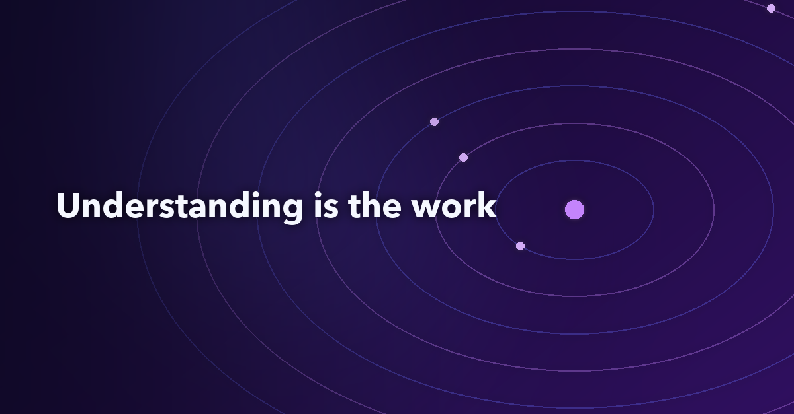

<!--
Medium metadata
Tags: Legacy Modernization, Banking, Software Architecture, Artificial Intelligence, COBOL
Meta description: The hard part of banking modernization is the knowledge buried in the code and proving equivalence. AI lowers the cost of understanding, not of correctness.
-->

# The hard part of banking modernization was never the COBOL

*AI makes legacy banking code cheaper to understand. It does not make a Java port correct, and in a bank proving equivalence is still the job*



*By [Wallace Espindola](https://www.linkedin.com/in/wallaceespindola/), Solution Architect | [wallace.espindola@gmail.com](mailto:wallace.espindola@gmail.com) | [GitHub](https://github.com/wallaceespindola/)*

*I wrote this article with AI assistance, then reviewed, fact-checked and edited it myself.*

---

Picture a code review for a small piece of a bank's core. The legacy side is one COBOL statement that computes monthly interest. The new side is one line of Java that does the same arithmetic with `BigDecimal`, scale two, banker's rounding. The reviewer reads both, nods and approves. The code is clean, the types are right, nobody used `double`. It is the port most of us would accept at first glance.

It is also wrong by one cent on several accounts. The COBOL statement has no `ROUNDED` phrase, so it truncates. The Java line rounds. On a balance of 1,000.00 at 5% a year, the legacy system has always paid 4.16 and the new code pays 4.17. Nothing about that difference shows up in a code review, because both lines look correct. It only shows up when you compare the outputs of the two systems, account by account.

That cent explains, better than any slide, what I think banking modernization is. It was never mainly a language problem. COBOL is old, but it is readable, and plenty of people can learn it. The hard part is the knowledge that lives in the code (interest, fees, rounding, eligibility, reconciliation rules nobody wrote down anywhere else) and the proof that the new system behaves the same way. AI changes the first part a lot. I don't think it should touch the authority over the second.

All the examples here come from a companion repository, [banking-modernization-with-ai](https://github.com/wallaceespindola/banking-modernization-with-ai): a context document, an illustrative COBOL program, a small Java 21 module with golden-master tests and a reconciler. This article is the opinion piece in a series. It says what I think AI changes in this work, what it must not do, and where my own argument gets weaker.

## The language was never the bottleneck

When people talk about mainframe modernization, the conversation drifts toward languages very quickly. COBOL to Java, COBOL to C#, which converter, which target framework. I understand why. The language is the visible part, and it is the part a tool can measure: lines in, lines out.

But think about what makes a change to a bank's core slow and risky today. The [context document](https://github.com/wallaceespindola/banking-modernization-with-ai/blob/main/docs/banking-modernization-with-ai-context.md) in the repo lists it, and very little of the list is about syntax:

- Business rules known by a few specialists and documented nowhere else.
- Thin automated tests.
- Shared copybooks and shared files acting as implicit contracts between programs that "do not talk to each other".
- Batch semantics such as cut-off times, end-of-day ordering, checkpoint and restart, "process exactly once per business date".
- Data definitions full of traps: `COMP-3` packed decimal, `REDEFINES`, implied decimal points, EBCDIC collation that sorts differently from ASCII.

None of that gets easier because the code is now Java. A line-by-line translation keeps every one of those assumptions and hides them in a language where readers no longer expect them. The context document has a name for the result, "JOBOL": Java that keeps the COBOL structure, coupling and batch assumptions, with none of the benefits. I have nothing against Java (I write a lot of it). My problem is with the idea that changing the language is progress by itself.

So my position is simple. The unit of change is a business capability such as interest accrual or statements, not a program and not a language. You modernize a capability when you understand what it does, can prove the new version does the same, and can switch the old one off. The language you end up in matters much less than those three things.

## What a cent hides

Back to the interest calculation, because the details matter. Here is the statement from the illustrative program in the repo, trimmed from `examples/cobol/INTCALC.cbl`:

```cobol
               COMPUTE WS-MONTHLY-INT =
                   ACCT-BALANCE * ACCT-ANNUAL-RATE / 1200
```

There is no `ROUNDED` phrase. In COBOL that means the result is truncated to the decimals of the receiving field, which here is a signed two-decimal packed field. So 4.1666 becomes 4.16, and for an overdraft, -1.6658 becomes -1.66. Truncation goes toward zero.

These are the two return lines from `InterestRule.java` in the repo. The first is the legacy-equivalent port, the second is the naive one, kept on purpose to show the break:

```java
        return balance.multiply(annualRatePercent).divide(MONTHS_TIMES_PERCENT, MONEY_SCALE, RoundingMode.DOWN);
        return balance.multiply(annualRatePercent).divide(MONTHS_TIMES_PERCENT, MONEY_SCALE, RoundingMode.HALF_EVEN);
```

The only difference is the rounding mode. `RoundingMode.DOWN` truncates toward zero, like COBOL without `ROUNDED`. `RoundingMode.HALF_EVEN` is banker's rounding, a perfectly reasonable default that a careful Java developer might pick for money.

The repo has a small golden file with eight accounts and the legacy result for each. It is an illustrative fixture worked out by hand from the COBOL semantics, not output captured from a real bank. Against that file, the naive port breaks on three of the eight accounts. ACC-0001 gets 4.17 instead of 4.16. ACC-0004, a balance just under a million, gets 3416.67 instead of 3416.66. ACC-0007, an overdraft, gets -1.67 instead of -1.66. The other five match, which is the dangerous part. A spot check could easily land on five good accounts and pass.

One cent per account per month doesn't sound like much. In a bank it is a reconciliation break, a customer statement that differs from last month's logic, a general-ledger total that no longer matches, and a question from audit that someone has to answer with evidence. The context document puts the tolerance policy for amounts at normally zero, and I agree with that default. In this world a one-cent difference counts as a defect.

Everybody already knows to be careful with rounding. What this small example adds is where the knowledge lived: in the code, in the absence of one word, and nowhere else. No spec said "truncate". The behavior was the spec. And you can only see that you broke it by comparing against the legacy system.

## What AI really changes: the cost of understanding

So where does AI fit? I think the answer is that it changes the economics of the expensive part, which is understanding, and that this matters more than the speed of writing code.

Typing Java was never what made these programs slow to replace. Reading them was. Someone had to open the program, follow the copybooks, find the paragraphs that matter, trace which fields flow where, notice the missing `ROUNDED`, and write all of that down in a form a domain expert could confirm. That work is slow, it depends on scarce people, and it is exactly the kind of work current models are good at helping with: summarizing a program, proposing candidate rules, explaining a data flow in plain language, generating edge cases for tests.

The repo has a rule catalog template with one worked example, BR-INT-001, for this interest rule. The entry carries a plain-language rule a domain expert can confirm, the inputs with their PIC clauses, the arithmetic ("no `ROUNDED` phrase, so the result is truncated toward zero to two decimals"), the edge cases (negative balances, zero, sub-cent results, maximum balance), the source location, fields for who extracted it (with which model and prompt version, recorded in a discovery log) and who approved it (the worked example keeps the name out), and links to the tests. I think that entry is the right shape for AI output in this work. AI can draft most of it. A domain expert approves it. The entry is not done until it links to the tests that prove the modern code matches.

The other thing I'd want any reader to notice is where the facts come from. The discovery pipeline in the context document puts deterministic parsers and static analysis first. They produce the dependency and data-lineage graph. The model explains and reasons over that graph instead of producing it. That keeps the dependency facts reproducible and pushes the risk of hallucination into the interpretation layer, where a person reviews it anyway. Every AI output carries its provenance: model and prompt version, source files and line ranges.


*The loop from the repo. AI sits mostly in the first stage. The second stage is where equivalence is decided, and it is decided by tests and reconciliation, not by a model.*

When I put it this way, the change AI brings looks less dramatic than the headlines and, to me, more useful. Once understanding is cheaper, the incremental path (one capability at a time, each one proven) stops looking like the slow and expensive option.

## What AI must not do: approve correctness

I feel most strongly about this part. AI must not independently approve banking correctness. That sentence is in the context document almost word for word, and it is the one I would put on the wall of any modernization team.

The reason is visible in the cent example. A model asked to port that `COMPUTE` statement might produce the `DOWN` version or the `HALF_EVEN` version. Both compile, both look idiomatic, both would pass a review that only reads code. If you then ask a model whether the port is correct, you are asking the same kind of system that might have made the mistake to grade its own homework. It may be right, but its answer is not evidence.

In a bank, the evidence has to come from somewhere deterministic. The context document is specific about where:

- **The legacy system is the test oracle:** characterization (golden master) tests capture legacy outputs for representative and edge-case inputs before anything changes. The model can suggest the inputs. The expected values come from the legacy system.
- **Differential testing with an agreed tolerance:** outputs compared field by field, and for amounts the tolerance is normally zero.
- **Reconciliation at three levels:** record, account balance and general-ledger totals per business date.
- **A parallel run:** at least one full business cycle that includes month-end and, when relevant, year-end.
- **A named human owner:** each approved rule, mapping and code change has a person who owns it. AI is recorded as an assistant, not an approver.

None of these steps needs AI to be trusted. AI proposes, deterministic tooling verifies, humans approve. If a model gets better next year, the gates stay the same, and that is what lets you adopt the better model without reopening the whole risk discussion.

There is a regulatory side too. In the EU, [DORA](https://eur-lex.europa.eu/eli/reg/2022/2554/oj) has applied since 17 January 2025. It covers ICT risk management, incident reporting, resilience testing and ICT third-party risk. An AI provider used on bank code is an ICT third party, and the context document says to register it as one. Models run inside the bank's approved perimeter, source code and data samples are masked or synthetic before they reach a model, comments in legacy code are treated as untrusted input (prompt injection matters when a model reads decades of free text), and model versions are pinned so results can be reproduced. Which of these rules bind a given institution is something to check with its own risk and compliance people. I'm describing the frame, not giving legal advice.

## Two paths from the same program

When I picture the choice a bank faces with one legacy program, I see two paths that start in the same place and end very differently.


*Same starting point, different evidence at the end. On the left, the tests describe the new code. On the right, they describe the old system.*

The rewrite-first path is attractive, and AI makes it more attractive. You can translate a lot of code quickly. The trap is in the second box. Once the tests are written from the new code, they describe what the new code does, including the `HALF_EVEN` line. They will pass. They will keep passing. The differences surface later, in reconciliation or in a customer complaint, after the cut-over weekend, when rollback is the most expensive.

The understand-first path spends more time before the first line of Java. It extracts the rule with a link to the source, gets it signed off, captures the legacy outputs, and only then builds the slice, which runs in shadow mode next to the mainframe until reconciliation says it is equivalent. The context document's recommended pattern is an incremental strangler with controlled coexistence: a routing layer per capability with instant fallback, an anti-corruption layer so legacy codes don't leak into the new model, change data capture instead of dual writes, and a single system of record per business date. It is the [Strangler Fig](https://martinfowler.com/bliki/StranglerFigApplication.html) idea applied with a bank's level of paranoia.

The two paths end with different evidence, "equivalence assumed" on one side and "equivalence proven" on the other, and in a bank only the second gives you a finished slice.

## The architect's job moves toward evidence

If AI lowers the cost of understanding, what is left for the solution architect? I think the job moves toward deciding what counts as proof, and making sure it gets produced.

Some of the work is familiar. Reconstruct the current state, define capabilities and domain boundaries with domain experts, set target and transition architectures, choose the consistency model per capability (strong for posting and balances, eventual for statements, analytics and notifications), and plan waves by value, feasibility and risk. AI can help with almost all of that, as long as its outputs are checked against the deterministic call and data graphs.

The part I'd want an architect to own personally is the set of quality gates: functional equivalence, reconciliation, observability, rollout and rollback. Go/no-go criteria agreed before the slice is built, not after. The tolerance policy, with a name next to it. A decommissioning date for each slice, because during coexistence the bank pays for both platforms and a plan that only builds never finishes. And regulatory evidence (ADRs, test evidence, reconciliation reports, change records) produced by the pipeline as it runs, instead of being assembled afterwards for an auditor.

The open questions in the context document are a good test of whether an initiative is ready. Which system is the book of record for each data element during coexistence? What is the tolerance policy for reconciliation differences, and who signs it off? Which AI models and hosting options are approved by security, risk and procurement? If nobody can answer those, I don't think the problem is the tooling.

## Where my argument gets weaker

I'd be overselling this if I didn't say where it doesn't hold as well.

**Not every capability needs this much ceremony.** The context document lists six strategies: retain, rehost, refactor, rearchitect, replace and retire. A stable core ledger with a low change rate may be better left on the mainframe and exposed through APIs. Dead or duplicated code should be retired, not understood in depth. Rule extraction and golden masters pay off where the business logic is dense and changes often. They are wasted effort on code nobody will touch again.

**The legacy system is the oracle, including its bugs.** Characterization tests capture what the system does, not what it should do. Sometimes the old behavior is a defect the business has lived with. In the worked example the overdraft truncation was confirmed as intended, but that was a decision a person made, not something the test could know. Changing behavior on purpose is a separate, explicit decision, and it should be logged as one.

**Equivalence is narrower than it looks.** My cent example is a single division. Production estates have intermediate precision that depends on compiler options (the Java comment in the repo says to pin it from the characterization tests before changing that line), batch restart semantics, century windowing from Y2K remediation and encoding conversions. A golden file of eight hand-worked rows shows the idea. It is nowhere near the coverage a real slice needs, which is why the plan calls for record and replay of masked transactions and a full business-cycle parallel run.

**AI-assisted discovery has to earn trust.** The context document suggests building an evaluation set early, programs whose rules are already known, and measuring extraction precision and recall before relying on the pipeline for unknown code. I don't have numbers from a live rollout to share, and I won't invent any. Until you have your own, treat AI summaries as candidates.

**Coexistence costs money.** Shadow runs, parallel runs and reconciliation mean running two platforms for a while. The business case has to include that cost, along with the cost of not acting: skills attrition and vendor end-of-support.

## Wrapping up

Here is what I think:

- Banking modernization is not a language problem. The hard part is the knowledge buried in the code and the proof that the new system does the same thing.
- The cent example is small on purpose. One missing word in COBOL decides the behavior, a reasonable Java default breaks it on three of eight illustrative accounts, and code review alone would not catch it.
- AI changes the cost of understanding: discovery, rule extraction, test inputs, discrepancy analysis. That is where it earns its place.
- AI must not approve correctness. The legacy system is the oracle, reconciliation decides, and a named person signs off.
- The architect's job moves toward evidence: quality gates, tolerance policies, decommissioning dates and regulatory evidence produced as the work happens.
- Rewrite first gives you equivalence assumed. Understand first gives you equivalence proven. In a bank only the second counts as done.

I'm curious where others draw the line. Would you let a model write the characterization tests if a human picks the expected values from legacy output? Who signs the tolerance policy where you work? And have you seen a one-cent difference turn into a much longer conversation than anyone expected? Let me know in the comments.

---

**Examples repository:** this article uses the context document, the illustrative `INTCALC` COBOL program, the `InterestRule` Java port with its golden-master test data, the BR-INT-001 rule catalog entry and the modernization loop diagram from <https://github.com/wallaceespindola/banking-modernization-with-ai>.

Need more tech insights?\
Check out my GitHub, LinkedIn, and Speaker Deck.\
Happy coding!

Wallace Espindola, Solution Architect\
GitHub: <https://github.com/wallaceespindola/>\
LinkedIn: <https://www.linkedin.com/in/wallaceespindola/>\
Speaker Deck: <https://speakerdeck.com/wallacese>
