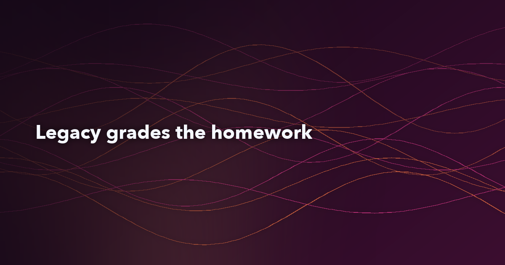

**Suggested subject line:** Your port looks right. Has the mainframe agreed?

*Preview text: One habit: the old system is the test oracle.*

---



# Let the bank's legacy system grade your homework

Hey folks,

A quick picture first. Somebody ports a COBOL interest calculation to Java. Maybe a developer did it by hand, maybe an AI assistant drafted it in a minute. The code is clean, it uses `BigDecimal`, the unit tests pass, and the reviewer approves it. Every check in that story came from the same people who wrote the port, so it only proves the port agrees with what they thought the rule was.

In a bank that's not good enough. The rule that matters is the one the mainframe has been running for years, including the parts nobody wrote down. So the habit I want to talk about is simple: before you trust any port, let the legacy system grade it. Capture what the old code actually produces, turn that into tests, and make the new code match it to the cent.

This issue is the coffee-length version: what the habit looks like, a one-cent example from the companion repo, where it doesn't pay off and what to try on Monday. Everything I show is in [banking-modernization-with-ai](https://github.com/wallaceespindola/banking-modernization-with-ai).


## Who grades the port

Most review processes have a circular step in them. The developer reads the COBOL, forms an opinion of what it does, writes Java and writes tests for that opinion. The reviewer reads both and checks they agree with each other. If the opinion was wrong, everything still goes green.

AI makes this worse. A model can produce a plausible port and a plausible test suite in the same session, and the two will agree perfectly. That's why the context file in the repo is blunt about it: in the testing row of the AI table the required control is "Legacy system is the test oracle, not the model." AI is useful here. It can draft characterization tests, list edge cases and explain discrepancies. It just doesn't get to decide what correct means.

The oracle is the system that already runs the bank. It has been audited, it runs the overnight batch, and its output is the definition of current behavior, quirks included. If the new code disagrees with it, the new code is wrong until a domain expert says otherwise.

## What the habit looks like

There are three steps, and they run in this order.

**Capture legacy outputs:** run the existing program on representative and edge-case inputs and keep what comes out, before anyone changes a line. In a real initiative that means replaying masked production transactions and batch inputs, not inventing test data from the spec.

**Write characterization tests:** Michael Feathers calls them [characterization tests](https://www.oreilly.com/library/view/working-effectively-with/0131177052/) because they describe what the code does, not what it should do. The captured outputs become the expected values. People also call this a golden master.

**Reconcile to the cent:** compare the port's results with the legacy results field by field, per account, and in total. The tolerance for amounts is normally zero. A cent off is a break, and so is an account that shows up on one side only.

Here's the rule the repo uses as its example. It's the monthly interest statement from `examples/cobol/INTCALC.cbl`, an illustrative program that isn't compiled:

```cobol
           IF ACCT-ACTIVE
      *        No ROUNDED phrase: the result is truncated to two decimals.
               COMPUTE WS-MONTHLY-INT =
                   ACCT-BALANCE * ACCT-ANNUAL-RATE / 1200
           ELSE
               MOVE ZERO TO WS-MONTHLY-INT
           END-IF.
```

It reads like one line of arithmetic. The detail that matters is what's missing. COBOL `COMPUTE` without `ROUNDED` truncates the result to the decimals of the receiving field, and `WS-MONTHLY-INT` is `PIC S9(11)V99 COMP-3`, so two decimals, cut toward zero. Nothing in the statement shouts that. You only notice if you know COBOL arithmetic well, or if the outputs tell you.

## One cent, three accounts

The golden data for that rule lives in `examples/java/src/test/resources/golden/monthly-interest.csv`. Here are the first rows. One caveat: it's an illustrative fixture I worked out by hand from the COBOL semantics, not output captured from a real bank. In a live project this file comes from a legacy batch run.

```csv
account,balance,annual_rate_percent,legacy_monthly_interest
ACC-0001,1000.00,5.00,4.16
ACC-0002,2500.00,3.75,7.81
ACC-0003,1234.56,2.50,2.57
ACC-0004,999999.99,4.10,3416.66
```

Look at ACC-0001. A balance of 1,000.00 at 5% gives 4.1666... per month. The legacy system says 4.16. A port that a reviewer would accept at first glance, using banker's rounding (`RoundingMode.HALF_EVEN`), says 4.17.

The repo keeps that naive port next to the real one on purpose, and a test reconciles both against the golden file. The naive version breaks on 3 of the 8 accounts:

- **ACC-0001:** legacy 4.16, naive port 4.17
- **ACC-0004:** legacy 3416.66, naive port 3416.67
- **ACC-0007:** legacy -1.66, naive port -1.67

The last one is an overdraft. Truncation goes toward zero, so a negative result gets cut the other way, which is exactly the kind of case people skip when they write tests from memory. The Java port that passes uses `RoundingMode.DOWN`, which is truncation toward zero, and matches every row.

A cent per account sounds small. Multiply it across every active account, every month, and reconciliation will find it at the general-ledger level, and somebody will have to explain the difference. I'd much rather find it in a unit test.

You can run all of it locally. From the repo root:

```bash
make test
```

That runs the Maven module in `examples/java`: the COMP-3 decoder tests, the golden-master tests for the interest rule (including the one that expects the naive port to break) and the reconciler tests. 17 tests, all green.

## Fix the rule, not the test

The habit has one rule that people break under deadline pressure. When the port and the legacy output disagree, you change the port, not the expected value.

It's tempting to look at 4.17 and think the new answer is "more correct", because it is closer to the exact value. Maybe it is, mathematically. It's still a change in financial behavior, and that's a business decision with a named owner. A migration shouldn't make it as a side effect. If the bank wants to start rounding, that goes through the rule catalog and a domain expert signs it off. The repo has a template for that, with BR-INT-001 as the worked example in `docs/templates/rule-catalog-entry.md`. Its arithmetic line spells out that there's no `ROUNDED` phrase, so the result is truncated toward zero, and its edge cases list negative balances, zero, sub-cent results and the maximum balance.

The same goes for things you can't see in the source. The catalog entry notes that intermediate precision depends on compiler options and is pinned by the characterization tests. You don't have to reverse-engineer every compiler setting up front. You let the outputs pin the behavior, and nobody edits the expected values to make a build pass.

## Where it doesn't pay off

The habit has a cost, and it's mostly in step one. Capturing legacy outputs means getting masked inputs, scheduling runs on the old platform and storing results somewhere the tests can reach. For a bounded, calculation-heavy rule like interest accrual or fees, that's cheap compared with what a wrong cent costs. For other work it fits less well.

- **Code you plan to retire:** if a function is dead or duplicated, the right move is to switch it off, not to characterize it.
- **Behavior the business wants to change:** if the new product is supposed to round differently, the golden master tells you where you differ, but it can't tell you the new rule. That still needs an expert.
- **Outputs you can't reproduce:** results that depend on time of day, external feeds or batch ordering need more work to capture. For those, record and replay plus a parallel run over a full business cycle (month-end included) does more than a CSV file.
- **Small samples:** eight rows show the idea. A production suite needs representative and edge-case inputs, and property-based tests are worth adding for rounding and accrual.

And none of this replaces reconciliation at the account balance and general-ledger level once a slice runs in shadow mode. Characterization tests catch the cent early, and reconciliation proves nothing else slipped.

## Try this on Monday

You don't need a modernization program to start. Pick one rule and run the loop once:

1. Pick one calculation from the legacy code that you'd be nervous to port: interest, a fee or a cap. Write down where it lives, program and paragraph.
2. Get the outputs of a real run for a set of masked inputs, with edge cases on purpose: zero, negative, sub-cent and the maximum value the field allows.
3. Put those rows in a CSV and write a parameterized test that reads it and asserts the expected value to the cent.
4. Port the rule, by hand or with AI, and run the test. Write down every break and its root cause.
5. Fix the port until it's green. If a break looks like a bug in the legacy code, take it to a domain expert instead of editing the CSV.

Then look at one thing: how many breaks you found that nobody predicted before the run. That count is a fair measure of how much of the rule was guesswork.

## The repo

Everything above is in a public repo, with the illustrative COBOL program and copybook, the Java 21 module, the golden CSV, the rule catalog template and the diagrams:

**<https://github.com/wallaceespindola/banking-modernization-with-ai>**

Start with `examples/cobol/INTCALC.cbl`, then open `InterestRuleGoldenMasterTest.java` under `examples/java/src/test` to see the naive port fail on three accounts.

## Wrapping up

A port is homework, whoever wrote it. The legacy system has the answer key, quirks included, so let it grade the work before anyone calls it equivalent. Capture the outputs first, make them the tests, reconcile to the cent and fix the rule, not the test.

My question for you: what's the smallest legacy rule that surprised you once you compared real outputs? Hit reply or drop a comment. I read every one.

**Examples repository:** this article uses the `INTCALC.cbl` interest rule, the golden CSV and golden-master tests, the reconciler, the BR-INT-001 rule catalog entry and the habit-loop diagram from <https://github.com/wallaceespindola/banking-modernization-with-ai>.

Need more tech insights?\
Check out my GitHub, LinkedIn, and Speaker Deck.\
Happy coding!

Wallace Espindola, Solution Architect\
GitHub: <https://github.com/wallaceespindola/>\
LinkedIn: <https://www.linkedin.com/in/wallaceespindola/>\
Speaker Deck: <https://speakerdeck.com/wallacese>
