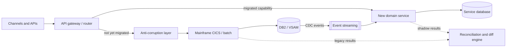
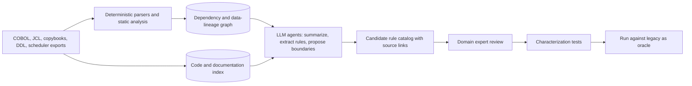

# Legacy Modernization in Banks and Financial Institutions

**Challenges, Solution Architecture, and AI Opportunities**

## Executive Summary

Banking modernization is not merely translating COBOL (Common Business-Oriented Language) into Java. The real challenge is transforming decades of embedded business rules, tightly coupled applications, financial data, and operational processes without disrupting banking services. A Solution Architect designs and governs that transformation; Artificial Intelligence (AI) can accelerate discovery, analysis, implementation, and verification.

Three principles frame everything below:

1. **Modernize capabilities, not code.** The unit of change is a business capability (fees, statements, payments initiation), not a program or a language. Line-by-line translation tends to produce "JOBOL": Java that keeps the COBOL structure, coupling, and batch assumptions, with none of the benefits.
2. **Correctness is proven, not assumed.** Every slice must demonstrate functional equivalence against the legacy system through characterization tests, parallel runs, and ledger-level reconciliation.
3. **AI proposes, deterministic tooling verifies, humans approve.** AI shortens discovery and implementation; it never becomes the authority on financial behavior.

## 1. Main Difficulties

### People and organization

- Scarcity of experienced mainframe and COBOL engineers and loss of institutional knowledge.
- Business rules known by a few specialists but inadequately documented.
- Siloed teams, risk aversion, unclear ownership, and resistance to changing stable systems.
- Skills gap between mainframe engineers and modern cloud/distributed-systems teams.
- Conway's law in reverse: the current org chart often mirrors the monolith, so new service boundaries fail unless team ownership changes with them.
- Incentive mismatch: run teams are rewarded for stability, change teams for delivery; modernization needs both.

### Technology and software

- Large, highly coupled applications, obsolete conventions, and hidden dependencies.
- Business rules embedded in code: interest, fees, rounding, eligibility, loans, tax, and reconciliation.
- Insufficient automated tests and hard-to-reproduce edge cases and batch cycles.
- Mainframe-specific job scheduling, interfaces, data formats, and tooling.
- Runtime stack beyond COBOL: CICS and IMS transactions, JCL, schedulers (for example Control-M, IBM Workload Scheduler, Broadcom CA-7), assembler routines, PL/I, REXX, and vendor packages.
- Dead and duplicated code: a significant share of the inventory is often unused or copied with small variations, which inflates scope if not identified early.
- Shared copybooks and shared files acting as implicit contracts between programs that "do not talk to each other".

### Architecture and integration

- Monolithic boundaries that do not align with business capabilities.
- Connections to payments, cards, risk, fraud, customer channels, and regulatory reporting.
- Overnight batch processing coexisting with modern real-time user experiences.
- Difficulties introducing modern engineering, observability, automated delivery, and resilience.
- Batch semantics that are easy to lose: cut-off times, end-of-day ordering, checkpoint/restart, generation data groups, and "process exactly once per business date".
- File-based and message-based integrations (MQ, fixed-width files, SWIFT/ISO 20022 transformations) with consumers that are not always known.

### Data and correctness

- Historic data stored in formats such as DB2 (Database 2), VSAM (Virtual Storage Access Method), and packed decimal.
- Currency precision, encoding conversions, rounding, lineage, and auditability.
- Data synchronization, duplicate processing, event ordering, and uncertain ownership during coexistence.
- Need for authoritative ledgers and rigorous reconciliation.
- COBOL data-definition traps: `COMP-3` packed decimal, signed zoned decimal (overpunch), `REDEFINES`, `OCCURS DEPENDING ON`, implied decimal points (`PIC 9(7)V99`), and EBCDIC collation that differs from ASCII sort order.
- Rounding and arithmetic semantics: COBOL truncates by default unless `ROUNDED` is specified, intermediate precision differs from Java; target code must use `BigDecimal` with explicit scale and `RoundingMode` per rule, never `double`.
- Dates and calendars: Julian dates, century windowing from Y2K remediation, business-day calendars, and time zones for cross-border processing.

### Risk, governance, and cost

- High availability, disaster recovery, security, access control, and transaction traceability.
- European obligations such as DORA (Digital Operational Resilience Act, applicable since 17 January 2025): ICT risk management, incident reporting, resilience testing, and ICT third-party risk, including cloud concentration risk and exit strategies.
- Related frameworks to check per institution: EBA guidelines on outsourcing and ICT risk, BCBS 239 (risk data aggregation), GDPR (personal data in test and training sets), PSD2 (payment services), and the EU AI Act where AI touches regulated decisions.
- Expensive coexistence, vendor dependencies, limited migration windows, and uncertain investment returns.
- Risk of replacing a reliable mainframe workload with a more complex and less reliable distributed design.
- Double-run cost: during coexistence the bank pays for both platforms, so the plan must decommission, not only build.

## 2. Modernization Strategy Options

No single strategy fits a whole bank. Decide per capability, using value, risk, and coupling as inputs.

| Strategy | What it means | Good fit | Main risk |
| --- | --- | --- | --- |
| Retain / encapsulate | Keep on mainframe, expose through APIs (for example z/OS Connect) | Stable core ledger, high throughput, low change rate | Skills risk persists; cost stays |
| Rehost / replatform | Move workload to emulated or containerized COBOL runtime | Exit pressure on hardware or licensing, low change demand | Same design, new operational complexity |
| Refactor (automated) | Tool-assisted conversion to Java or C# | Large estate, well-tested, short timeline | "JOBOL", maintainability not improved |
| Rearchitect / rebuild | Re-implement capability as domain services | High-change, differentiating capabilities | Rule loss, long parallel run |
| Replace (package/SaaS) | Adopt a modern core banking product | Commodity capabilities | Customization creep, vendor lock-in |
| Retire | Decommission unused or duplicated functionality | Dead code, obsolete products | Hidden consumers |

### Recommended pattern: incremental strangler with controlled coexistence

Key elements:

- **Routing layer** to switch traffic per capability, product, or customer segment, with instant fallback.
- **Anti-corruption layer** so legacy data models and codes do not leak into new domain models.
- **Change data capture (CDC)** instead of dual writes, to keep a single writer per data element during coexistence.
- **Shadow mode and parallel run**: new service computes results without committing; differences are reconciled before cut-over.
- **Single system of record per business date**, documented explicitly, to avoid ledger ambiguity.

## 3. Where the Solution Architect Helps

- Reconstruct the current-state architecture: inventory applications, interfaces, data flows, jobs, and dependencies.
- Define business capabilities and domain boundaries with domain experts.
- Establish target and transition architectures, including workload placement decisions.
- Define secure interfaces, data ownership, integration, and transaction consistency strategies.
- Plan incremental modernization waves based on value, feasibility, and risk.
- Govern quality gates: functional equivalence, reconciliation, observability, rollout, and rollback.
- Coordinate business, risk, operations, security, and engineering stakeholders.
- Document architecture decisions, risks, trade-offs, and measurable outcomes.
- Choose the consistency model per capability: where strong consistency is mandatory (posting, balances), where eventual consistency is acceptable (statements, analytics, notifications), and how sagas or compensations apply.
- Define non-functional targets up front: throughput at end-of-day peaks, latency budgets, RPO/RTO, and batch window duration, so the target design is measured against the mainframe it replaces.
- Make the business case honest: total cost of coexistence, decommissioning milestones, and the cost of not acting (skills attrition, vendor end-of-support).
- Embed regulatory evidence into the delivery pipeline (ADRs, test evidence, reconciliation reports, change records) instead of producing it afterwards.

### Architecture anti-patterns to prevent

- Big-bang replacement of a core system with a single cut-over weekend.
- Distributed monolith: many services sharing one database or calling each other synchronously for every posting.
- Dual writes from application code into legacy and new stores.
- Translating batch jobs one-to-one into microservices without rethinking the processing model.
- Using floating-point types or default rounding for monetary values.
- Treating observability, idempotency, and replay as post-go-live work.

## 4. Where AI Helps

| Area | AI contribution | Required control |
| --- | --- | --- |
| Legacy discovery | Summarize programs, copybooks, job definitions, and dependency relationships. | Ground summaries on parser output; cite file and line. |
| Business-rule extraction | Identify candidate rules with exact source traceability for expert validation. | Domain expert sign-off; rule catalog with status. |
| Architecture reconstruction | Help generate diagrams, inventories, and dependency maps. | Compare against deterministic call/data graphs. |
| Domain modeling | Suggest candidate bounded contexts and service boundaries based on evidence. | Validate with coupling metrics and domain workshops. |
| Code modernization | Assist transformations and refactoring, with engineering review. | Code review, static analysis, characterization tests must pass. |
| Data mapping | Propose schema translations and identify potentially inconsistent records. | Profiling on real (masked) data; reconciliation of migrated totals. |
| Testing | Generate characterization tests and edge cases; analyze discrepancies between old and new behavior. | Legacy system is the test oracle, not the model. |
| Knowledge transfer | Searchable assistance over approved code and documentation. | Access control mirrors source permissions; answers cite sources. |
| Prioritization | Compare migration candidates by complexity, coupling, benefits, and risk. | Architect decides; scoring model is transparent. |
| Operations | Explain abends, job failures, and reconciliation breaks from logs and runbooks. | Read-only access; no autonomous production actions. |

### Reference AI-assisted discovery pipeline

Design notes:

- The graph comes from deterministic tools; the LLM explains and reasons over it. This keeps dependency facts reproducible and reduces hallucination to the interpretation layer, where review happens anyway.
- Every AI output carries provenance: model and prompt version, source files, and line ranges.
- Build an evaluation set early (programs whose rules are already known) and measure extraction precision and recall before trusting the pipeline on unknown code.

### AI governance and security

AI must not independently approve banking correctness. Use deterministic parsers and static analysis where possible, and require human review, authoritative test oracles, financial reconciliation, and secure model deployment.

- **Deployment**: models run inside the bank's approved perimeter (private endpoints or on-premise), with contractual guarantees on data retention and training use; register the provider as an ICT third party under DORA.
- **Data protection**: source code is intellectual property and may contain hard-coded data; test and production samples must be masked or synthetic before reaching a model.
- **Prompt injection**: comments and strings in legacy code are untrusted input to the model; agents get least privilege and no write access to production systems.
- **Reproducibility**: pin model versions, store prompts and outputs, and re-run evaluations on every model upgrade.
- **Accountability**: a named human owns each approved rule, mapping, and code change; AI is recorded as an assistant, not an approver.

## 5. Testing and Verification Strategy

Equivalence is the main acceptance criterion for every slice.

- **Characterization (golden master) tests**: capture legacy outputs for representative and edge-case inputs before changing anything.
- **Record and replay**: replay masked production transactions and batch inputs against both systems.
- **Differential testing**: compare outputs field by field, with an agreed tolerance policy (normally zero for amounts).
- **Property-based testing** for arithmetic: rounding, interest accrual, fee caps, currency conversion.
- **Reconciliation at three levels**: record, account balance, and general-ledger totals per business date.
- **Parallel run** for at least one full business cycle that includes month-end and, when relevant, year-end processing.
- **Operational tests**: failover, restart in the middle of a batch, duplicate message handling, and replay.

## 6. Suggested Incremental Initiative (90 Days)

### Choosing the first capability

Prefer a capability that is **valuable enough to matter, bounded enough to finish**:

- Clear business owner and available domain experts.
- Low write coupling to the core ledger (read-heavy or calculation-heavy, for example fee calculation, statement generation, or customer inquiry).
- Measurable outputs that can be compared with legacy results.
- Visible pain today (change backlog, skills risk, cost).

### Plan

| Phase | Activities | Exit criteria |
| --- | --- | --- |
| **Days 1–30** | Select a bounded banking capability, inventory legacy programs and dependencies, capture risks, establish baseline metrics, and interview domain experts. | Scope signed off; inventory and dependency graph; baseline metrics; risk register; AI usage approved by security and risk. |
| **Days 31–60** | Build an AI-assisted discovery proof of concept, catalog candidate business rules, map data and service boundaries, and produce characterization test cases. | Rule catalog with validation status; data mapping; characterization suite running against legacy; evaluation results for AI extraction. |
| **Days 61–90** | Implement one controlled modernization slice, compare results against the legacy system, measure discrepancies and operational behavior, and produce the target architecture and roadmap. | Slice running in shadow mode; reconciliation report; target and transition architecture; ADRs; prioritized roadmap with business case. |

### Governance during the initiative

- Weekly architecture and risk checkpoint with business, operations, security, and compliance.
- Decisions recorded as ADRs from day one.
- Go/no-go criteria for production traffic agreed before the slice is built, not after.

## 7. Success Measures

Define each metric with a baseline in phase 1 and a target agreed with stakeholders.

| Measure | How to measure |
| --- | --- |
| Discovery effort | Person-days to document a program or capability, with and without AI. |
| Business rules validated | Rules confirmed by experts / candidate rules extracted. |
| Rule extraction quality | Precision and recall on the evaluation set. |
| Critical dependency coverage | Dependencies identified and verified / dependencies found later in testing. |
| Regression and characterization coverage | Rules and paths covered by automated tests. |
| Reconciliation discrepancies | Count and value of breaks per business date, by root cause. |
| Defect escape rate | Defects found after go-live / total defects. |
| Change lead time | Request to production for the migrated capability, before and after. |
| Operational resilience | Incidents, MTTR, RPO/RTO met in tests, batch window adherence. |
| Cost | Run cost of legacy plus new during coexistence; MIPS/MSU reduction achieved. |
| Business value | Capability-specific outcome (time to launch product, customer experience). |

## 8. Open Questions to Resolve Early

- Which system is the book of record for each data element during coexistence?
- What is the tolerance policy for reconciliation differences, and who signs it off?
- Which AI models and hosting options are approved by security, risk, and procurement?
- What are the regulatory notification or approval requirements for material ICT changes?
- What is the decommissioning plan and date for each migrated legacy component?

## Key Message

The greatest opportunity for a Solution Architect using AI is to turn undocumented legacy banking systems into understandable, testable, and incrementally modernizable business capabilities, while preserving financial correctness and operational risk controls.

---

**Author:** Wallace Espindola, Solution Architect, [wallace.espindola@gmail.com](mailto:wallace.espindola@gmail.com) · [LinkedIn](https://www.linkedin.com/in/wallaceespindola/) · [GitHub](https://github.com/wallaceespindola/)
