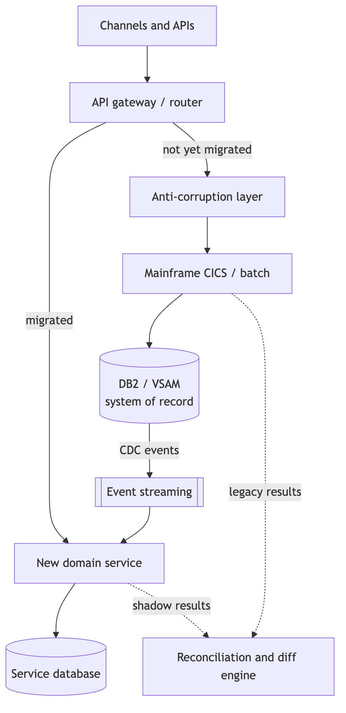
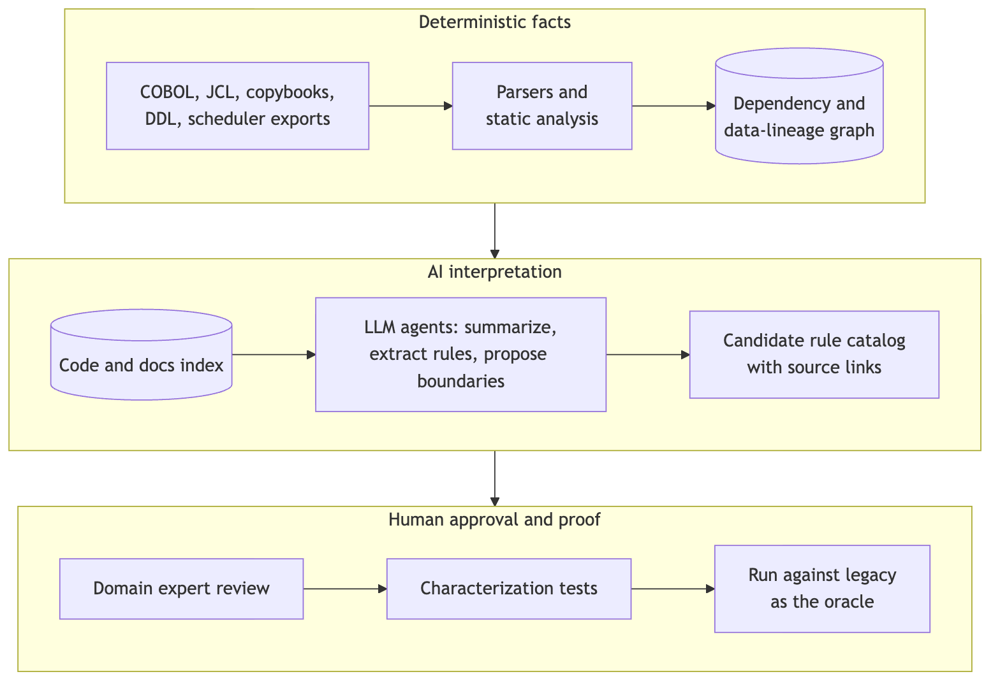

<!-- _class: lead -->
<!-- _backgroundColor: '#0d1b3e' -->
<!-- _color: '#ffffff' -->
<!-- _paginate: false -->

# Understand, Then Modernize: AI and the Solution Architect in Banking Legacy

**Wallace Espindola**
Solution Architect

<wallace.espindola@gmail.com>
linkedin.com/in/wallaceespindola | github.com/wallaceespindola

<!--
Hi, I'm Wallace, a solution architect. This talk is about modernizing the legacy core of a bank, and where AI fits into that work.
My position in one line: the job is to understand the system first and modernize it second. AI can make the understanding part faster. It should not be the one deciding whether the money is right.
Everything I show, including a small COBOL program, its Java port and the tests, is in a public repo. Link at the end.
-->

---

# The problem: knowledge buried in code

- Decades of **interest, fee, rounding, eligibility and reconciliation** rules
- Written down **only in the code**, known by a few specialists
- Batch cycles nobody fully remembers
- Data formats that break naive conversions
- Mainframes stay because they are **fast, stable and audited**

Rewrite before you understand, and you replace a reliable system with a less reliable one.

<!--
Banking modernization is not a COBOL to Java translation job. The hard part is the knowledge in the code.
Banks keep mainframes for good reasons. What erodes is everything around them: the people who know the rules are retiring, tests are thin, and every change is slow and risky.
AI makes a faster rewrite tempting. But the bottleneck was never typing speed. It was understanding.
-->

---

# Why it is hard

| Area | Typical difficulty |
|---|---|
| People | Scarce COBOL skills, rules known by few, org chart mirrors the monolith |
| Technology | Coupled programs, CICS/IMS, JCL and schedulers, dead and duplicated code |
| Integration | Payments, cards, risk, reporting; overnight batch next to real-time channels |
| Data | DB2, VSAM, `COMP-3`, encoding, dates, rounding, sync during coexistence |
| Risk and cost | Availability, DORA, double-run cost, a less reliable target |

<!--
I group the difficulties in five areas.
People: skills are scarce, and the org chart often mirrors the monolith, so new service boundaries fail unless ownership changes with them.
Technology: the runtime is more than COBOL. CICS, IMS, JCL, schedulers, shared copybooks acting as implicit contracts.
Integration: many consumers, not all of them known, and batch semantics that are easy to lose.
Data: the traps are on the next slide.
Risk: in Europe, DORA expects operational resilience and control over third parties, including cloud and AI providers. And during coexistence the bank pays for two platforms.
-->

---

# The data traps generic lists leave out

- `COMP-3` packed decimal, signed zoned decimal, `REDEFINES`, `OCCURS DEPENDING ON`
- Implied decimal points: `PIC 9(7)V99`
- EBCDIC collation is not ASCII sort order
- **COBOL truncates** unless `ROUNDED` is specified
- Julian dates, century windowing, business-day calendars
- Batch restart: checkpoints, end-of-day ordering, exactly once per business date

Target code uses `BigDecimal` with explicit scale and `RoundingMode`, never `double`.

<!--
These are the details that break a conversion that looks correct.
The one I'll come back to is rounding. A COBOL COMPUTE without the ROUNDED phrase truncates. Java developers reach for rounding by habit. That gap is worth a cent per account, and I'll show it on real code later.
-->

---

# Three principles

1. **Modernize capabilities, not code.** The unit of change is a business capability, not a program or a language.
2. **Correctness is proven, not assumed.** Characterization tests, parallel runs and ledger-level reconciliation decide when a slice is done.
3. **AI proposes, deterministic tooling verifies, humans approve.**

<!--
Everything else in the talk follows from these three.
Line-by-line translation tends to produce what people call JOBOL: Java that keeps the COBOL structure, coupling and batch assumptions, with none of the benefits.
And one practical corollary: decommission, don't just build. Every slice needs a date when the legacy part is switched off, or the bank pays for two platforms indefinitely.
-->

---

<!-- _class: diagram -->

# The modernization loop


<!--
This is the loop for one capability.
Understand: parsers and static analysis map the estate, AI turns the map into readable summaries and candidate rules, and domain experts sign the rules off.
Prove and move: the legacy system is the test oracle, one slice is modernized behind a strangler and an anti-corruption layer, and a shadow run with reconciliation verifies it.
Finish: cut over and decommission. If verification finds breaks, you go back to the rules, not to the code.
-->

---

# Strategy options, decided per capability

| Strategy | Good fit | Main risk |
|---|---|---|
| Retain / encapsulate | Stable core ledger, low change rate | Skills risk and cost stay |
| Rehost / replatform | Hardware or licensing exit, low change | Same design, new ops complexity |
| Refactor (automated) | Large, well-tested estate, short timeline | "JOBOL", no maintainability gain |
| Rearchitect / rebuild | High-change, differentiating capability | Rule loss, long parallel run |
| Replace (package/SaaS) | Commodity capability | Customization creep, lock-in |
| Retire | Dead or duplicated code | Hidden consumers |

<!--
No single strategy fits a whole bank. Decide per capability, using value, risk and coupling as inputs.
A stable core ledger with a low change rate may be best left on the mainframe and exposed through APIs. A differentiating capability that changes every quarter is a candidate to rebuild. Dead code should simply be retired, once you've checked nobody still reads its output.
-->

---

# Strangler with controlled coexistence



- **Router** switches traffic per capability, product or segment, with instant fallback
- **Anti-corruption layer** keeps legacy codes out of the new model
- **CDC, not dual writes:** one writer per data element
- **Shadow mode:** the new service computes, does not commit
- **One system of record** per business date, written down

<!--
The recommended pattern is an incremental strangler with controlled coexistence.
The gateway routes migrated capabilities to the new service and everything else through the anti-corruption layer to the mainframe. The mainframe stays the system of record. Change data capture feeds the new service, so nobody writes to both stores from application code.
In shadow mode both sides produce results and the reconciliation engine compares them before any cut-over.
-->

---

# The architect's job

- Reconstruct the current state: applications, interfaces, jobs, data flows
- Define capabilities and domain boundaries **with domain experts**
- Set target and transition architectures
- Choose the **consistency model** per capability
- Set non-functional targets: end-of-day peaks, RPO/RTO, batch window
- Plan waves by value and risk; govern equivalence, reconciliation and rollback gates
- Record decisions as ADRs; keep the business case honest

<!--
The architect owns the shape of the transformation.
Two items I'd stress. First, the consistency model: posting and balances need strong consistency, statements and notifications can be eventual. Decide it per capability, not once for the program.
Second, non-functional targets up front, so the new design is measured against the mainframe it replaces.
And prevent the usual anti-patterns: big-bang cut-over weekends, a distributed monolith on one shared database, dual writes, and floating point for money.
-->

---

# Where AI helps, and the control for each

| Area | AI contribution | Required control |
|---|---|---|
| Discovery | Summarize programs, copybooks, jobs | Ground on parser output; cite file and line |
| Rule extraction | Candidate rules with source links | Expert sign-off; rule catalog with status |
| Domain modeling | Candidate bounded contexts | Coupling metrics and workshops |
| Code modernization | Assist refactoring | Review, static analysis, tests pass |
| Testing | Characterization tests, discrepancy analysis | Legacy is the oracle, not the model |
| Operations | Explain abends and breaks | Read-only; no autonomous actions |

<!--
Every AI use case comes with a control. That pairing is the point of this slide.
The context file in the repo has the full table, including architecture reconstruction, data mapping, knowledge transfer and prioritization.
Notice the pattern: AI produces a candidate, and something deterministic or someone accountable checks it.
-->

---

<!-- _class: diagram -->

# Reference AI-assisted discovery pipeline



<!--
Three layers. The dependency and data-lineage graph comes from deterministic parsers, so dependency facts are reproducible.
The LLM explains and reasons over that graph and the code index, and produces a candidate rule catalog with source links.
Then people take over: domain experts review, characterization tests are written, and they run against the legacy system as the oracle.
Build an evaluation set early, programs whose rules you already know, and measure extraction precision and recall before trusting the pipeline on unknown code.
-->

---

<!-- _class: lead -->
<!-- _backgroundColor: '#0d1b3e' -->
<!-- _color: '#ffffff' -->

# The guardrail

## AI must not independently approve banking correctness

Deterministic parsers and static analysis first. Then human review, the legacy system as test oracle, financial reconciliation and secure model deployment.

<!--
If you remember one rule from this talk, make it this one.
On governance: models run inside the bank's approved perimeter, and under DORA the provider is an ICT third party. Data reaching a model is masked or synthetic. Comments and strings in legacy code are untrusted input, so agents get least privilege. Model versions are pinned and prompts stored. And a named human owns each approved rule; AI is recorded as an assistant, not an approver.
-->

---

<!-- _class: code -->

# One cent: the legacy rule

Rule BR-INT-001, monthly interest, from `examples/cobol/INTCALC.cbl`:

```cobol
           IF ACCT-ACTIVE
      *        No ROUNDED phrase: the result is truncated to two decimals.
               COMPUTE WS-MONTHLY-INT =
                   ACCT-BALANCE * ACCT-ANNUAL-RATE / 1200
           ELSE
               MOVE ZERO TO WS-MONTHLY-INT
           END-IF.
```

No `ROUNDED`, so the result is **truncated toward zero** to two decimals.

<!--
Here is a small, illustrative example from the repo. Balance times annual rate in percent, divided by 1200, for active accounts. Closed accounts accrue nothing.
The detail that matters is what is missing: there is no ROUNDED phrase. So COBOL truncates the result to the two decimals of the receiving field.
The rule catalog entry for BR-INT-001 in the repo records that, along with the edge cases: negative balances, zero, sub-cent results.
-->

---

<!-- _class: code -->

# Two Java ports, one of them wrong

From `InterestRule.java`:

```java
// Legacy-equivalent: truncation toward zero, like COBOL without ROUNDED
return balance.multiply(annualRatePercent)
    .divide(MONTHS_TIMES_PERCENT, MONEY_SCALE, RoundingMode.DOWN);

// The port a reviewer would accept at first glance: banker's rounding
return balance.multiply(annualRatePercent)
    .divide(MONTHS_TIMES_PERCENT, MONEY_SCALE, RoundingMode.HALF_EVEN);
```

Both use `BigDecimal`. Only one matches the legacy system.

<!--
These are the two return lines from the Java class, trimmed for the slide.
Both use BigDecimal with an explicit scale, so neither has the floating-point problem. The second one uses HALF_EVEN, banker's rounding, which looks responsible and would pass a code review.
It is still not what the legacy system does. You only find out by comparing against the legacy outputs.
-->

---

# The golden master catches it: 3 of 8 accounts break

| Account | Balance | Rate % | Legacy (DOWN) | Naive (HALF_EVEN) |
|---|---|---|---|---|
| ACC-0001 | 1000.00 | 5.00 | **4.16** | 4.17 |
| ACC-0004 | 999999.99 | 4.10 | **3416.66** | 3416.67 |
| ACC-0007 | -100.00 | 19.99 | **-1.66** | -1.67 |

The other 5 accounts match. Fixture: `monthly-interest.csv`, **illustrative, worked out by hand from the COBOL semantics**.

<!--
The golden CSV has eight accounts. To be clear: it is an illustrative fixture I worked out by hand from the COBOL semantics, not output captured from a real mainframe.
Against it, the naive port breaks on three of eight accounts, each by one cent. ACC-0007 is an overdraft: truncation toward zero gives minus 1.66, rounding gives minus 1.67.
One cent sounds small. Multiplied across accounts and months, it is a reconciliation break on every business date, and a conversation with the regulator.
-->

---

# Testing and reconciliation

- **Golden master:** capture legacy outputs before changing anything
- **Record and replay** masked production transactions on both systems
- **Differential testing** field by field, tolerance normally zero for amounts
- **Property-based testing** for rounding, accrual, fee caps, FX
- **Reconcile at three levels:** record, account balance, general ledger per business date
- **Parallel run** over a full cycle with month-end
- **Operational tests:** failover, mid-batch restart, duplicates, replay

<!--
Equivalence is the main acceptance criterion for every slice. The one-cent example is a characterization test doing its job.
Reconciliation happens at three levels, because a match at record level can still hide a break in ledger totals.
The parallel run covers at least one full business cycle including month-end, and year-end when it is relevant.
-->

---

# A first 90-day initiative


- **Days 1-30, scope:** one bounded capability, inventory, risks, baseline metrics
- **Days 31-60, discover:** AI discovery PoC, rule catalog, characterization tests
- **Days 61-90, prove:** one slice in shadow mode, reconciliation report, roadmap

Pick a capability **valuable enough to matter, bounded enough to finish**.

<!--
Pick a capability with a clear business owner, low write coupling to the core ledger and outputs you can compare: fee calculation, statement generation or customer inquiry are typical.
Each phase ends at a gate. Scope and AI use approved by security and risk. Rules validated by experts. And zero unexplained breaks before the go/no-go for production traffic.
Agree the go/no-go criteria before the slice is built, not after, and record decisions as ADRs from day one.
-->

---

# How to know it is working

| Measure | How to measure |
|---|---|
| Discovery effort | Person-days per program or capability, with and without AI |
| Business rules validated | Confirmed by experts / candidates extracted |
| Rule extraction quality | Precision and recall on the evaluation set |
| Reconciliation discrepancies | Count and value of breaks per business date, by root cause |
| Change lead time | Request to production, before and after |
| Cost | Legacy plus new during coexistence; MIPS/MSU reduction |

<!--
I'm not showing numbers here, because these depend on your institution. Set a baseline for each one in the first phase and agree a target with stakeholders.
The full list in the repo also covers dependency coverage, characterization coverage, defect escape rate, operational resilience and business value.
-->

---

# Open questions to settle early

- Which system is the **book of record** for each data element during coexistence?
- What is the **tolerance policy** for reconciliation differences, and who signs it off?
- Which **AI models and hosting** are approved by security, risk and procurement?
- What are the **regulatory notification** requirements for material ICT changes?
- What is the **decommissioning date** for each migrated component?

<!--
These questions stall initiatives when they come up late. Put them on the agenda of the first architecture checkpoint.
Regulatory details differ per institution and they change, so check DORA, EBA guidelines and the EU AI Act with your own compliance team.
-->

---

<!-- _class: lead -->
<!-- _backgroundColor: '#0d1b3e' -->
<!-- _color: '#ffffff' -->

# Key message

Turn undocumented legacy banking systems into **understandable, testable and incrementally modernizable** business capabilities, while preserving financial correctness and operational risk controls.

<!--
That is the greatest opportunity for a solution architect using AI. Not a faster rewrite, but faster understanding, with the proof still done by tests, reconciliation and people.
-->

---

<!-- _class: lead -->
<!-- _backgroundColor: '#0d1b3e' -->
<!-- _color: '#ffffff' -->
<!-- _paginate: false -->

# Resources

**Repo (context, rule catalog, COBOL and Java examples):**
github.com/wallaceespindola/banking-modernization-with-ai

**Wallace Espindola**, Solution Architect
GitHub: github.com/wallaceespindola
LinkedIn: linkedin.com/in/wallaceespindola
Speaker Deck: speakerdeck.com/wallacese

*Thanks! Questions?*

<!--
The repo has the full context file, the rule catalog template with the BR-INT-001 example, the COBOL excerpt, and the Java module with the golden-master test and a reconciler.
Its companion, legacy-modernization-patterns, covers the migration patterns themselves.
Thanks. Happy to take questions.
-->
